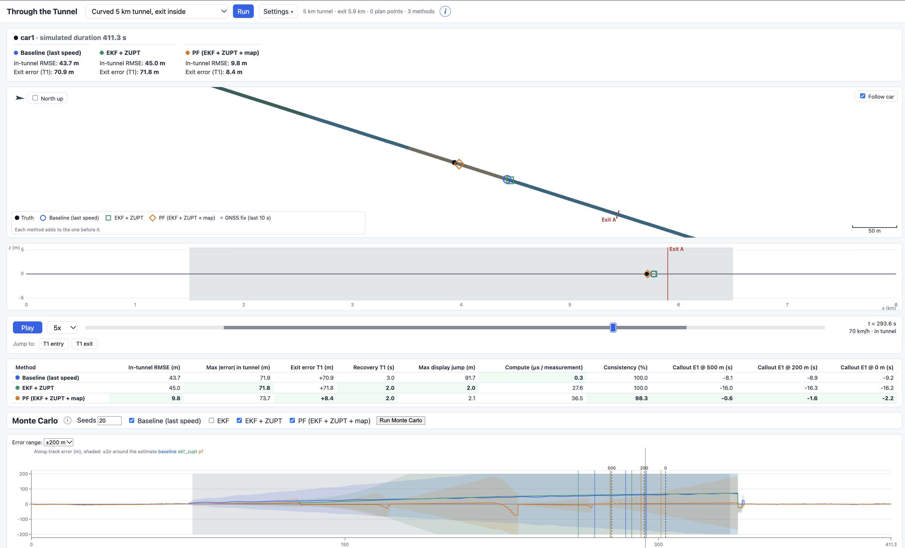

# Through the Tunnel

[](https://github.com/hfelek/through-the-tunnel/actions/workflows/ci.yml)

A simulator and a set of position estimators for a car driving through a GPS-denied tunnel (the Pointr case study, see
[docs/CASE.md](docs/CASE.md)). The key insight: inside a single-lane tunnel on a known route the problem is
one-dimensional, so the only unknown that matters is the distance travelled along the road. The methods are layered on top
of each other: a baseline (last speed), an EKF that fuses the phone's IMU with GNSS and beacons, the same EKF with
zero-velocity updates at stops (EKF+ZUPT), and a particle filter that adds map matching on curves. Underneath sit the phone
alignment (finding the car's forward axis from the sensors, also after the phone is picked up) and the exit callouts
("exit in 500 m", "200 m", "now").



## Quick start

Prerequisites: Python 3.11 or newer, Node.js 20.19 or newer (with npm; Vite 8 needs it), and `make`.

```
git clone https://github.com/hfelek/through-the-tunnel.git
cd through-the-tunnel
python -m venv .venv
source .venv/bin/activate          # Windows: .venv\Scripts\activate
pip install -e '.[dev]'
(cd web && npm ci)
make dev
```

For the exact versions the project was tested with, run `pip install -r requirements-lock.txt` before `pip install -e '.[dev]'` (optional).

Open http://localhost:5173 in a browser (the API runs on port 8000). The tests and the UI build run in CI on Linux, macOS and Windows (Python 3.12), and the tests also on Python 3.11. Measured on a clean clone: install about 1 min, `make test` about 80 s. `make dev` starts both servers and reloads on edits;
Ctrl+C stops them.

### Windows

`make` is not needed. In PowerShell, from the repository root:

```
py -m venv .venv
.venv\Scripts\Activate.ps1      # if PowerShell blocks it: Set-ExecutionPolicy -Scope CurrentUser RemoteSigned
pip install -e ".[dev]"
cd web; npm ci; cd ..
```

Then start the two servers in two terminals:

```
# Terminal 1 (venv active)
uvicorn sim.api.main:app --port 8000

# Terminal 2
cd web; npm run dev
```

Open http://localhost:5173. The `make` targets as plain commands (arguments go at the end of each line):

| make target | Windows command |
| --- | --- |
| `make test` | `pytest -q` |
| `make lint` | `ruff check -q` |
| `make montecarlo ARGS="..."` | `python -m sim.eval.montecarlo ...` |
| `make summary` | `python -m sim.eval.summary` |
| `make sweep ARGS="..."` | `python -m sim.eval.sweep ...` |
| `make figures` | `python -m sim.eval.summary`, then `python -m sim.eval.sweep --figures` |

## Using the simulator

- **Scenario picker** (top bar): pick a scenario and press *Run*. The map, the elevation profile, the timeline, the metrics
  table and the error charts show the truth and every selected estimator; the timeline plays the drive back.
- **Settings** (top bar): the phone preset, sensor options, the estimators and their parameters, and the scenario JSON.
  With *auto-run* on, every change runs again at once.
- **Driving plan**: edit the speed points, stops and traffic sections of the car and see the effect immediately.
- **Error chart**: the *Bands* switch shows the ±2σ bands overlaid, in one row per method on a shared scale, or not at all.
- **Monte Carlo panel** (under the metrics table): runs the current scenario and settings with 20 different seeds (about
  30 s on a 4-core laptop) and shows the spread of the exit error per estimator.
- The backend simulates several vehicles in one tunnel: each follows the one ahead with a 15 m minimum gap (A10, A13)
  and has its own sensors and estimators. The UI shows only the first vehicle, and all evaluation scenarios have a
  single vehicle.

## Real recording

The picker's *Source* switch has a second mode, *Real recording*: a 14-minute city drive recorded with a phone (Sensor Logger,
iPhone placed in the car's charging tray, in `data/real/car_mounted/`). Pick a recording, set the outage window in recording seconds (default 515
to 625) and press *Run*. GNSS is removed in the window, as if the car were in a tunnel, and the removed fixes serve as the
truth. The map comes from the drive's own GNSS, so the result is a replay check and not a map-quality test. Auto-run is
off here: a replay takes about 10 s. Recovery time is not shown: GNSS returns clean after the artificial outage, so it would be about 0 s for every method and would not separate them. The first run converts the CSV files and caches them in `data/real/cache/`.

## Scenarios

15 scenarios, described in [scenarios/README.md](scenarios/README.md). The write-up uses eight of them:
`speed_changes_3km`, `stop_and_go_3km`, `curved_5km_exit_inside`, `beacons_5km`, `budget_phone_5km`,
`phone_in_hand_2min`, `phone_in_hand_whole_trip` and `twin_tunnels_short_gap`.

## Results

Simulation results: median absolute exit error over 300 seeds per scenario:

- Speed changes: 1046 m for the baseline, 88 m for the EKF.
- Stop-and-go: 18 m with ZUPT (the baseline saturates at 1500 m).
- 5 km curved tunnel: 21 m with the particle filter, 109 m for the baseline.
- No missed callout in 18,000 runs.
- On one real drive with an artificial tunnel the simulation proved optimistic (see section 6 of the write-up).

Details: [docs/WRITEUP.md](docs/WRITEUP.md) and [docs/results/summary.md](docs/results/summary.md).

## Reproducing the results

The simulation is deterministic: every random draw comes from a seeded generator. All commands run from the repository
root with the virtual environment active.

| Command | What it does | Time |
| --- | --- | --- |
| `make montecarlo ARGS="--seeds 300"` | The main study: all scenarios and estimators, resumable CSV in `docs/results/runs.csv` | about 1.5 h on 8 cores |
| `make montecarlo ARGS="--study a30 --seeds 50"` | A side study (`a30` or `beacon_sigma`) | minutes |
| `make sweep ARGS="--sweep accel_bias --seeds 30"` | Accelerometer-bias sweep (or `--sweep tunnel_length`) | about 15 min on 4 cores; 3 min for the tunnel-length sweep |
| `make summary` | Tables and the overview plot from the CSVs | seconds |
| `make figures` | Every table and figure, including the sweeps, from the CSVs | seconds |
| `python tools/diagnose_real.py` | The real-drive diagnosis (write-up section 6.3 and Table 3) | about 2 min |

Add `--jobs N` inside `ARGS` to set the number of processes. An interrupted run continues where it stopped.

## Extending

- **A scenario**: add a JSON file to `scenarios/` (the format is section 3.2 of [docs/CONTRACTS.md](docs/CONTRACTS.md)),
  then update the scenario counts in `tests/test_api.py` and `tests/test_scenarios.py`. The picker lists it without a
  frontend change. [docs/CODE_TOUR.md](docs/CODE_TOUR.md) section 12 has the recipe.
- **An estimator**: write a class that implements the `Estimator` protocol (`sim/contracts/estimation.py`), decorate it
  with `@register` (`sim/estimators/registry.py`), give every parameter a default, a label and a description. The API and
  the UI pick it up from the registry; nothing in `web/` names an estimator.
- **Tests and lint**: `make test` (pytest), `make lint` (ruff), `cd web && npm run build`.

## Documentation map

| File | Content |
| --- | --- |
| [docs/WRITEUP.md](docs/WRITEUP.md) | The write-up: approach, assumptions, results, limitations |
| [docs/CASE.md](docs/CASE.md) | The original case text |
| [docs/ASSUMPTIONS.md](docs/ASSUMPTIONS.md) | Numbered assumptions (A1, A2, ...) with sources |
| [docs/CODE_TOUR.md](docs/CODE_TOUR.md) | Where everything is in the code, data flow, recipes for common changes |
| [docs/CONTRACTS.md](docs/CONTRACTS.md) | The data shapes: scenario, trace, API, units and frames |
| [PLAN.md](PLAN.md) | The task plan and its change log |
