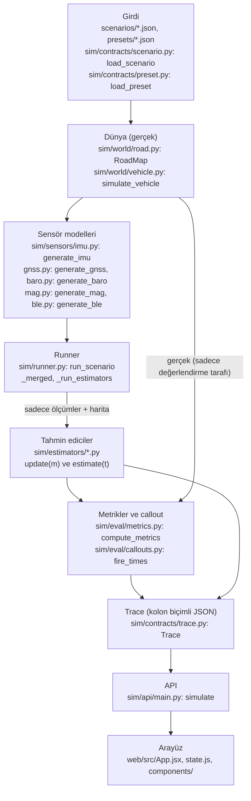

# Çalışma kılavuzu: kod nasıl çalışıyor

Bu kılavuz, incelemeden önce kodun akışını ve sensör modellerini çalışmak için yazıldı. Kod ve test değişmedi.
`docs/WRITEUP.md` ile çelişmemesine özen gösterildi; çelişme gibi görünen yerlerde WRITEUP esas alındı.

**Nasıl okunur.** Dosya adları ve `dosya:satır` referansları bu kılavuz yazılırken kodda kontrol edildi. Satır numaraları
zamanla kayar; fonksiyon adı kalıcı olan bağlantıdır. Bir şeyi kodu okuyarak değil, dokümandan veya mantıktan çıkardıysam
yanına **(çıkarım)** yazdım. Ayrıntılı kaynaklar: `docs/CODE_TOUR.md` (kodun haritası), `docs/ASSUMPTIONS.md` (A1, A2, ...),
`docs/design/T8.2_ekf.md`, `docs/design/T8.4_pf.md`, `presets/README.md`, `scenarios/README.md`, `docs/CONTRACTS.md`.

Kısa sözlük: **s** yol boyunca konum (m). **v** hız. **b** ivmeölçer ofseti (kodda ve arayüzde "bias" denir; WRITEUP
"offset" der, aynı şeydir). **σ** (sigma) bir tahminin belirsizliği, yani standart sapması. **EKF** genişletilmiş Kalman
filtresi. **ZUPT** sıfır hız güncellemesi. **PF** parçacık filtresi. **GNSS** uydu konumu (telefonda GPS).

---

## 1. Büyük resim

Proje bir döngüdür: önce bir **dünya** (yol ve araba) yaratılır, bu dünyada telefonun **sensörlerinin ne okuyacağı**
üretilir, bu okumalar **tahmin ediciye** (estimator) verilir, tahmin edicinin cevabı **gerçekle** karşılaştırılır ve sonuç
ekranda gösterilir. Tahmin edici gerçek konumu hiçbir zaman görmez; sadece harita ve sensör okumalarını görür.



### Her kutu ne yapar

1. **Girdi.** Senaryo JSON'u yolu, tünelleri, çıkışları, sürüş planını, telefonun montajını ve tohumu (seed) tanımlar.
   `load_scenario` (sim/contracts/scenario.py) bunu doğrular; bilinmeyen anahtar hatadır (`extra="forbid"`). Preset JSON'u
   telefonun sensör değerlerini taşır; her değerin yanında bir `source` alanı vardır (`load_preset`, sim/contracts/preset.py).
2. **Dünya.** `RoadMap` (sim/world/road.py) merkez çizgisini 1 m aralıkla tutar: x, y, z, yön, eğrilik, eğim. `at(s)` bir
   konumun özelliklerini verir, `project(x, y)` bir GNSS konumunu en yakın yol noktasına, yani bir `s` değerine çevirir.
   `simulate_vehicle` (sim/world/vehicle.py) sürüş planını yürütür ve **gerçeği** üretir: `t, s, v, a, yaw, pitch, ...`.
3. **Sensör modelleri.** Her sensör gerçeği, preset değerlerini ve **kendi rastgele sayı üretecini** alır; geriye zaman
   sütunlarıyla bir sözlük döner. Bölüm 3 bunları sensör sensör anlatır.
4. **Runner.** `run_scenario` (sim/runner.py:128) her şeyi bir araya getirir. `_merged` (:72) tüm ölçümleri tek bir listeye
   dizer: önce zamana, eşitlikte sensör sırasına göre. `_run_estimators` (:89) her çıktı anı için `m.t <= t` olan ölçümleri
   sırayla `update`'e verir, sonra `estimate(t)` çağırır. Gerçek yalnızca bundan sonra metrik hesaplarında kullanılır.
5. **Tahmin ediciler.** Dört yöntem vardır: baseline, EKF, EKF+ZUPT, PF. Ortak arayüz `reset`, `update(m)`, `estimate(t)`
   (sim/contracts/estimation.py). `@register` (sim/estimators/registry.py) bir yöntemi kayda ekler; API ve arayüz kayıttan
   okur, arayüzde yöntem adı yazılı değildir.
6. **Metrikler.** `compute_metrics` (sim/eval/metrics.py:34) hatayı `tahmin - gerçek` olarak hesaplar: çıkış hatası,
   tünel içi RMSE, tutarlılık, kurtarma süresi, ekranda görünen sıçrama. `fire_times` (sim/eval/callouts.py:14) callout'ları
   üretir.
7. **Trace.** Hepsi kolon biçimli tek bir JSON'dur (`Trace`, sim/contracts/trace.py). Eksik sensör alan olarak yoktur, null yazılmaz.
8. **API.** `POST /api/simulate` (sim/api/main.py:89) tahmin edici ve parametre adlarını doğrular, `run_scenario`'yu çağırır,
   trace'i seyreltip (varsayılan 10 Hz) döndürür.
9. **Arayüz.** `web/src/App.jsx` API'yi çağırır; senaryo JSON'u `state.js`'te **tek doğruluk kaynağıdır**, her kontrol onu düzenler.

### Gerçeğin tahmin ediciye sızmaması

- Tahmin ediciler `sim/estimators/` altında yalnızca `RoadMap` ve `Measurement`/`Estimate` tiplerini kullanabilir; araç
  hareketi veya sensör üretimi içe aktarılamaz (CLAUDE.md sert kuralları; CODE_TOUR bölüm 11 bunu nerede zorladığımızı listeler).
- Tahmin ediciler **nedenseldir**: durum yalnızca zaman sırasıyla gelen `update(m)` ile değişir.
- Tüm rastgelelik tohumlu bir `numpy.random.Generator`'dan gelir; global `np.random` yoktur.

### Tohum nasıl bölünür

Tek bir senaryo tohumu birçok bağımsız akışa ayrılır (sim/runner.py:137 ve :141):

```
np.random.SeedSequence(scenario.seed).spawn(1 + araç_sayısı)
   ├─ [0]  hareket (sürücü titreşimi vb.)
   └─ her araç için bir SeedSequence → .spawn(5), sırayla: imu, gnss, baro, mag, ble
```

Sensör sırası sabittir (`KINDS`, sim/runner.py:37; kodda "asla yeniden sıralama" yazar). Sonuç: bir sensörün preset'ini
değiştirmek diğer sensörlerin gürültüsünü değiştirmez, ve aynı tohum her zaman aynı koşuyu verir (tests/test_runner.py).
Monte Carlo'da seed k için `derive_seed` (sim/eval/montecarlo.py:65): k = 0 senaryonun kendi tohumudur, diğerleri
`SeedSequence([tohum, k])`'dan türetilir. PF'in tohumu da buna bağlanır; seed 0, PF'in varsayılan tohumunu korur.

### Bölüm 1 için üç inceleme sorusu

**S1. Tahmin edicinin gerçeği görmediğini nasıl garanti ediyorsunuz?**
C: Runner tahmin ediciye yalnızca `Measurement` nesneleri ve haritayı verir (sim/runner.py `_run_estimators`). Gerçek ayrı
bir `Truth` nesnesidir ve yalnızca metrik tarafında kullanılır. Testler tahmin edicinin zaman sırasıyla ölçüm gördüğünü
doğrular (tests/test_runner.py). Bunu tür sistemi değil, paket sınırı ve test garanti eder.

**S2. Neden sonuçlar tekrarlanabilir?**
C: Tek tohum `SeedSequence` ile bağımsız akışlara bölünür; sabit sensör sırası ve global rastgelelik yasağı bunu tamamlar.

**S3. Neden problem tek boyutlu?**
C: Tek şeritli tünelde araç geçemez ve rota bilinir (A1); harita merkez çizgiyi, eğrilik ve eğimi verir (A2). Bilinmeyen tek
şey yol boyunca konumdur. Her ölçüm `s` veya türevleri hakkında bilgiye dönüşür (WRITEUP bölüm 1).

---

## 2. Tek bir ölçümün yolculuğu

İki ölçümü baştan sona izleyelim: bir IMU örneği ve bir GNSS fix'i. (IMU örnek sözleşmesinde 100 Hz, GNSS 1 Hz'dir;
`rates_hz` senaryoda ayarlanır, CONTRACTS 3.2.)

### 2.1 Bir IMU örneği

1. **Gerçekte ne oluyor.** Araç yolda ilerliyor. `simulate_vehicle` her IMU adımında `s, v, a` ve yol eğriliğinden
   `yaw_rate = v · eğrilik` ile `a_lat = v² · eğrilik` hesaplar. Eğim `pitch`'i belirler (sim/world/vehicle.py).
2. **Sensör neyi ölçer.** Telefon "özgül kuvvet" ölçer: `force = [a + g·sin(θ), a_lat, a_dikey + g·cos(θ)]`
   (`_vehicle_signals`, sim/sensors/imu.py:118). Düz duran bir telefon z'de +9,81 okur. Bu kuvvet, montaj dönüşümüyle telefon
   eksenlerine çevrilir (`_to_phone`); montajı **tahmin edici bilmez**.
3. **Hatalar eklenir** (`generate_imu`, sim/sensors/imu.py:140): `okuma = gerçek · ölçek + bias + beyaz gürültü + titreşim`.
   Ayrıntı bölüm 3.1'de.
4. **Runner'a girer.** `_merged` onu bir `Measurement(t, kind="imu", data={ax,...,gz})` yapar ve diğer ölçümlerle zamana göre dizer.
5. **EKF'e ulaşır.** `update(m)` (sim/estimators/ekf.py:131) `kind == "imu"` görür ve `_imu` (:148) çağırır.
6. **Hizalayıcı.** `_imu` ilk iş olarak `aligner.process_imu(m, s_tahmin, v_tahmin)` çağırır (alignment.py:327). Hizalayıcı ham
   telefon ivmesini **aracın ileri ivmesine** (`a_long`) çevirir ve eğimin sızdırdığı yerçekimini çıkarır:
   `a_long = f·a - g·sin(atan(eğim(s_tahmin)))`. Eğim, **EKF'in kendi konumunda** aranır (bu geri besleme WRITEUP bölüm 7'deki
   sınırlamalardan biridir). Hizalayıcı aynı zamanda telefonun elle tutulup tutulmadığını (`mode`) ve örneğin geçerli olup
   olmadığını (`valid`) söyler.
7. **Tahmin adımı.** Geçerli ise ve güven kuralı izin veriyorsa EKF ivmeyi kullanır:
   `acc = a_long - b - d_psi · v · yaw_rate`, sonra `s += v·dt + ½·acc·dt²`, `v += acc·dt`. Aksi halde sabit hız modeli
   kullanılır (bölüm 4.3).
8. **Ek güncellemeler.** Hız sınırını aşıyorsa zayıf bir hız-sınırı güncellemesi; EKF+ZUPT'ta araç duruyorsa sıfır hız
   güncellemesi (`_stationary_updates`, :219); BLE paketleri için ayrı yol (bölüm 4.5).
9. **Ekran konumu.** Her IMU adımında `_advance_display` (:197) ekranda gösterilen konumu günceller (bölüm 4.3.6).

### 2.2 Bir GNSS fix'i

1. **Gerçekte.** `generate_gnss` (sim/sensors/gnss.py:51) 1 Hz'lik bir ızgara üzerinde gerçek konuma zamanla ilişkili bir
   hata ekler. Tünel içinde satır yoktur.
2. **Runner.** `Measurement(kind="gnss", data={x, y, z, speed, course, h_acc, speed_acc})`.
3. **EKF.** `update` önce `aligner.process_gnss(m)` çağırır (hizalayıcı fix aralığını kalibrasyon kaydına çevirir), sonra
   `_gnss(m)` (ekf.py:252):
   - `s_meas = road.project(x, y)`: konumu haritaya oturtur.
   - `sig_s = h_acc / 1,5096`: yarıçap-%68 doğruluğunu eksen başına sigma'ya çevirir (`R68_TO_AXIS`).
   - **Yanal kontrol:** fix, yoldan `lateral_k · sig_s` (varsayılan 3σ) daha uzaksa bozuk sayılır ve atılır.
   - İlk fix `s` ve `v`'yi başlatır. Sonrakiler `_kalman(...)` ile `[s, v]` ölçümü olarak uygulanır, ki-kare kapısı 13,8.
   - Kapıdan 5 fix üst üste dönerse `_reinit_from_fix` filtreyi fix'ten yeniden başlatır (bölüm 4.3.4).
4. **Zaman damgası.** Kabul edilen fix `_t_acc`'yi günceller. Bu, "GNSS güncel mi" sorusunun cevabıdır (son kabul edilen
   fix'ten bu yana en fazla `gnss_timeout_s` = 1,5 s).

### 2.3 Haritadaki konuma

1. Her çıktı anında runner `estimate(t)` çağırır (ekf.py:304); geri dönen `Estimate` içinde `s, v, sigma_s, mode` ve
   `extras["display_s"]` vardır.
2. Runner bunları `EstimateColumns` kolonlarına yazar (`t, s, v, sigma_s, display_s, mode`).
3. Trace API'den arayüze gider. Arayüz `web/src/lib/trace.js` içinde `shown = display_s` (varsa) seçer; yoksa `s`.
   Haritadaki ok bu `shown` değerinden yol üzerinde çizilir (çıkarım: çizim bileşenini satır satır okumadım).
4. Callout'lar `display_s`'i değil, ham `s`'i ve `sigma_s`'i kullanır.

### Bölüm 2 için üç inceleme sorusu

**S1. Ekrandaki ok neden doğrudan EKF'in `s`'i değil?**
C: GNSS tünel çıkışında geri geldiğinde `s` aniden sıçrayabilir. `display_s` tahmine her saniye `display_k` = 0,5 oranında
yaklaşır, hızı en fazla `v + 10 m/s` olabilir ve asla geri gitmez. Ok sıçramaz (T8.6, A31).

**S2. Yanal kontrolün amacı ne?**
C: Tek şeritli yoldan 3σ'dan fazla uzak bir fix, yansıma gibi bozuk bir fix'tir; haritaya oturtulursa yanlış `s` verir.
Atılması filtreyi korur.

**S3. EKF neden kendi konumunu hizalayıcıya veriyor?**
C: Eğimin yerçekimi sızıntısını doğru yerde çıkarmak için. Dezavantajı: konum hatalıysa yanlış yerin eğimi kullanılır; bu geri
besleme WRITEUP bölüm 6.3 ve bölüm 7'de bir sınırlama olarak yazılıdır (gerçek sürüşte gerçek konumda arama hatayı −1693 m'den
−1301 m'ye indirdi).

---

## 3. Sensör verisi nasıl üretilir

Genel kural: **her üretici tüm rastgele sayılarını baştan çeker**; böylece akış seçeneklere (örneğin tünel etkilerinin açık
olmasına) bağlı olmaz. Her üretici gerçeği (`VehicleMotion`), `RoadMap`'i, preset'i ve kendi tohumlu üretecini alır.

Preset mantığı: `flagship_2024` Bosch BMI260 (IMU) ve BMP390 (barometre) veri sayfalarına ve GPS.gov doğruluk rakamlarına dayanır.
`budget` aynı değerlerin 2–4 kat büyütülmüşüdür (A16), çünkü ucuz telefon veri sayfaları nadiren yayımlanır
(`presets/README.md`).

### 3.1 IMU (ivmeölçer ve jiroskop) — A14, A16, A17

**Ne modellenir.** Telefonun 3 eksenli ivmeölçeri ve jiroskopu. Gerçek sinyal bölüm 2.1'deki özgül kuvvet ve dönme hızıdır;
telefonun montajı sabit bir rotasyondur, el hareketi ise sürekli bir rotasyon yoludur (`MountPath`, `_EventPath`).

**Formül** (sim/sensors/imu.py: `_errors` ve `generate_imu`):

```
okuma = gerçek · ölçek + bias(t) + beyaz + titreşim
ölçek   = 1 + U(-1, 1) · ölçek_hatası_max          (koşu başına bir kez, eksen başına)
bias(t) = U(-1, 1) · başlangıç_bias_max  +  rastgele yürüyüş
rastgele yürüyüş = Σ N(0, bias_random_walk · √dt)
beyaz   = N(0, gürültü_yoğunluğu / √dt)
titreşim = (v0 + k · v_araç) · N(0, 1)
```

**Flagship değerleri** (`presets/flagship_2024.json`):

| Parametre | Değer | Kaynak |
| --- | --- | --- |
| İvmeölçer gürültü yoğunluğu | 1,57·10⁻³ m/s²/√Hz (160 µg/√Hz) | BMI260 veri sayfası |
| İvmeölçer başlangıç bias'ı | ±0,196 m/s² (±20 mg) | BMI260 |
| İvmeölçer bias rastgele yürüyüşü | 3,65·10⁻⁴ m/s²/√s | sıcaklık katsayısı 0,25 mg/K × 2 K, A14 |
| Jiroskop gürültü yoğunluğu | 1,40·10⁻⁴ rad/s/√Hz | BMI260 |
| Jiroskop başlangıç bias'ı | ±8,73·10⁻³ rad/s | BMI260 |
| Jiroskop rastgele yürüyüşü | 5,2·10⁻⁵ rad/s/√s | 0,02 °/s/K × 2 K, A14 |
| Ölçek hatası | ±0,4 % | preset |

**Titreşim (A17).** Rölanti: ivmeölçer 0,03 m/s², jiroskop 0,002 rad/s RMS. Hareket halinde: ivmeölçer `0,03 + 0,01·v`
m/s², jiroskop `0,002 + 0,0005·v` rad/s. Bu değerler "duran" ve "giden" durumu ZUPT için ayrılabilir kılmak için seçildi;
ayarlanabilirdir. Gerçek sürüşte titreşim yaklaşık iki katı çıktı (WRITEUP bölüm 6.1).

**El tutma (handling).** Ölçüm gürültüsü değil, bir yönelim yoludur: yaklaşık 1 s'lik bir kaldırma, tutarken 10–30 s'de bir
yaklaşık 20° yeniden yönelme, el titremesi. Tutarken ivmeölçere ek 2 m/s² el gürültüsü bindirilir.

**Neden önemli.** Sabit bir ivmeölçer ofseti `b`, konum hatasını `½·b·t²` büyütür; `presets/README.md`: kalibre
edildikten sonra kalan 0,005 m/s² ofset 180 s'de yaklaşık 80 m eder. Bu yüzden sonuçlar en çok bias rastgele yürüyüşüne
duyarlıdır.

### 3.2 GNSS — A15, A18, A19

`generate_gnss` (sim/sensors/gnss.py:51).

- **Konum hatası.** Birinci dereceden Gauss–Markov süreci, eksen başına, korelasyon süresi 30 s (A15). `_gauss_markov`
  birim varyanslı seri üretir; `err = birim · σ · [1, 1, 1,5]`. Düşey hata yataydan 1,5 kat büyüktür (A18).
- **σ.** Flagship için 2 m (GPS.gov: 4,9 m yarıçap %95 ≈ 2 m tek eksende 1σ).
- **Portal etkisi (A19).** Portala `portal_degrade_m` içinde (örnek senaryoda 60 m) hata ve bildirilen `h_acc` doğrusal olarak
  5 katına çıkar (`_portal_factor`).
- **Erişim** (`_availability`): tünel içinde fix yoktur. Çıkıştan sonra `reacquire_delay_s` (örnek: 2–6 s) rastgele gecikme,
  ardından `bad_fixes_after_exit` (örnek: 3) bozuk fix: ek yanlış `bad_fix_error_m` (örnek: 25 m) rastgele yönde.
- **`h_acc` dürüsttür.** Bozuk fix'te bildirilen doğruluk gerçek hataya göre büyütülür (`h_acc = RADIAL_68 · σ`). Bu yüzden
  EKF bu fix'leri küçük ağırlıkla kabul eder (WRITEUP bölüm 2).
- **Hız ve yön.** Hız: gerçek hız + `N(0, 0,15 m/s)` (A15). Yön: harita yönü + gürültü, düşük hızda son yön korunur.

### 3.3 Barometre — A20, A21, A22

`generate_baro` (sim/sensors/baro.py:48). Hiçbir yöntem barometreyi **kullanmaz** (WRITEUP bölüm 4); simülatörde, trace
formatında ve `undersea_3km_dip` senaryosunda kalır ki gerçek bir tünel kaydıyla denenebilsin.

```
basınç = standart atmosfer(yükseklik)         p = p0 · (1 - 2,25577·10⁻⁵ · h)^5,25588
       + beyaz (1,2 Pa)
       + rastgele yürüyüş (0,089 Pa/√s)
       + tünel basınç adımı (20 Pa, 1 s zaman sabitiyle, A21)
       + fan dalgalanması (8 Pa, Gauss–Markov, 10 s, A22)
```

- Taban yükseklik deniz seviyesidir (A20); tahmin ediciler yalnızca göreli basınç kullanabilirdi.
- Tünel girişinde basınç adımı üstel yükselir, çıkışta aynı şekilde düşer.
- A34 (CR2): PF'te barometre eşleştirmesi yoktur, çünkü tünel havalandırması ve trafik basıncı belgelenmemiş miktarlarda
  değiştirir ve bir eğimin yükseklik sinyalini aşabilir.

### 3.4 Manyetometre — A23

`generate_mag` (sim/sensors/mag.py:27): Dünya alanı telefon eksenlerine çevrilir (montaj yolu IMU ile paylaşılır) + tünel
içinde uzaysal Gauss–Markov bozukluğu (10 m korelasyon uzunluğu, senaryoda `mag_disturbance_ut`, örnek 25 µT, A23) +
açık gökyüzünde 0,3 µT gürültü (A15). Hiçbir tahmin edici kullanmaz; "tünelde neden kullanılamaz" sorusunu göstermek için vardır.

### 3.5 BLE işaretçileri (beacon) — A24, A25, A26

`generate_ble` (sim/sensors/ble.py:25), `beacon_positions` (:14).

- İşaretçiler tünel içinde `başlangıç + k · aralık` konumlarına yerleştirilir (örnek: 400 m). Konumlar **harita bilgisidir**:
  runner onları `RoadMap.beacons`'a yazar ve tahmin edici kullanabilir.
- Her işaretçiden her 0,1 s'de bir paket gelir. `RSSI = tx_güç - 10 · n · log10(d) + N(0, 4 dB)`; `tx_güç` 1 m'deki RSSI'dır
  (örnek −59 dBm), `n` yol kaybı üssü (2,2), gürültü paket başına bağımsızdır (A24).
- Mesafe `d` boylamsal mesafe ile sabit yanal 2,5 m ve düşey 2 m'den hesaplanır, yani en yakın geçiş yaklaşık 3,2 m'dir (A26).
- −90 dBm altı paket hiç alınmaz (A25); bu yaklaşık 25 m'lik bir algılama menzili verir.

### 3.6 Sürüş ve tohumlar (özet)

Sürücü hızı, "tutulan hız artı yavaş rastgele titreşim" olarak modellenir: 4 kosinüsün toplamı, frekanslar 0,02–0,1 Hz,
std = `speed_jitter_kmh` (A27). Bu titreşim baseline'ın ivmeölçersiz hata kaynağının büyük kısmıdır. Hız değişimleri
sarsıntı sınırlı S-eğrileriyle yapılır (A11, 2 m/s³). Tohumlar için bölüm 1'e bakın.

### Bölüm 3 için üç inceleme sorusu

**S1. Sensör sayıları nereden?**
C: Her preset değerinin `source` alanı vardır: BMI260 ve BMP390 veri sayfaları, GPS.gov, sıcaklık katsayılarından türetilen
sürüklenme (A14). Veri sayfası olmayanlar (GNSS korelasyon süresi, manyetometre gürültüsü, titreşim) varsayım olarak
numaralanmış ve etkisiyle yazılmıştır (A15, A17). Bütçe telefon, flagship'in çarpanlarla ölçeklenmiş halidir (A16).

**S2. Simülasyon iyimser mi?**
C: Evet, ivmeölçer ofsetinin değişimi veri sayfası kadar yavaş varsayıldı. Gerçek bir sürüş bunun çok daha hızlı değişebildiğini
gösterdi (WRITEUP bölüm 6 ve 7), bu yüzden metre değerlerinden çok sıralamalar (neyin yardım ettiği) güvenilirdir.

**S3. Neden BLE gürültüsü paket başına bağımsız?**
C: Basit ve açıklanabilir bir varsayım (A24); yayınlanan ölçümlerde birkaç dB'den 10 dB üzerine kadar değişir, tünel için
kaynak yoktur. Gürültü büyürse RSSI tepe noktası genişler ve işaretçi tespiti gecikir/kayar.

---

## 4. Yöntemler: birbirinin üstüne nasıl kurulur

Sıra: baseline → hizalayıcı → EKF → ZUPT → işaretçiler → parçacık filtresi → callout kuralı. Her yöntem bir önceki
yönteme **bir bilgi kaynağı ekler**, böylece her katmanın katkısı ölçülebilir.

### 4.1 Baseline (sim/estimators/baseline.py)

- **Girdi.** Yalnızca GNSS fix'leri. **Çıktı.** `s, v, sigma_s`.
- **Çalışma.** Son fix'in konumunu ve hızını tutar. Son fix'ten sonra `gap_timeout_s` = **1,5 s** geçene kadar son fix'in hızını
  kullanır; GNSS bundan daha uzun süre yoksa son `n_speed_fixes` (3) fix'in hızının **ortalamasını** kullanır. Tünelin içinde
  bu ortalamayla sabit hızda ilerler: `s = s_fix + v_ort · dt`. Belirsizlik doğrusal büyür:
  `sigma = sigma_fix + sigma_rate_mps · dt` (`estimate`, baseline.py:69; satır 75).
- **Ne zaman iyi.** Araç gerçekten sabit hızda gidiyorsa sabit hız doğru modeldir; uzun, düz, sabit hızlı tüneller (WRITEUP bölüm 5.2).
- **Anahtar parametreler.** `gap_timeout_s` = 1,5 s (eski fix'e ne kadar güvenileceği; artırırsan eski fix daha uzun süre kullanılır),
  `n_speed_fixes` = 3 (ortalamaya giren fix sayısı), `sigma_rate_mps` = 0,5 m/s (bildirilen belirsizliğin saniyedeki büyümesi;
  yalnızca bildirilen sigma'yı değiştirir, konumu değil).

### 4.2 Hizalayıcı (Aligner, sim/estimators/alignment.py)

**Bir yöntem değil, EKF'in içinde bir hazırlık adımıdır**; EKF, EKF+ZUPT ve PF bunu kullanır, baseline kullanmaz. EKF `reset`
içinde bir `Aligner` oluşturur (ekf.py:74).

- **Neden gerekli.** Telefon montaj içinde bilinmeyen bir yönelimdedir. İvmeölçeri kullanmadan önce "aracın ileri ekseni
  telefonun hangi ekseni?" sorusu cevaplanmalıdır.
- **Girdi.** Telefonun IMU örnekleri, GNSS fix'leri (hız değişimi için), EKF'in `s` ve `v` tahmini (eğim araması için).
- **Çıktı.** `AlignedSample`: `a_long` (aracın ileri ivmesi), `sigma_a_long`, `yaw_rate`, `valid`, `mode`
  (`uncalibrated`, `aligned`, `in_hand`, `realigned`), `sigma_tilt`, `mount_changed`.
- **Nasıl.** Açık yolda, GNSS varken (`_solve`, :195):
  1. "Yukarı" ekseni: düz yolda ortalama ivmeölçer.
  2. Jiroskop bias'ı: düz, doğrusal sürüşte ortalama jiroskop.
  3. İleri eksen: ölçülen ivme ile GNSS hız değişiminden beklenen ivme arasındaki 2 boyutlu Procrustes uyumu (`_fit`, :180).
     Artık hata `sigma_psi` olarak EKF'e geçer.
- **Kalibrasyon koşulları.** Yol düz (`flat_grade`, varsayılan %0,5) ve doğrusal (`straight_curvature`, 1e-4) olmalı,
  GNSS güncel olmalı. Gerçek kayıtta bunlar %3 ve 2·10⁻³'e gevşetildi (`REAL_DEFAULTS`, sim/realdata/replay.py); aksi halde
  telefon hiç kalibre edilmedi (WRITEUP bölüm 6.3).
- **El tutma algılama.** Yalnızca jiroskoptan: 0,2 s ortalamalı jiroskop eksi bias eksi beklenen araç dönmesi 0,15 rad/s'yi
  0,2 s aşarsa başlar, 0,03 rad/s altında 1 s kalırsa biter (A29). Fren gibi ivmeli olaylar ivmeölçer kullanılmadığı için
  yanlış tetiklemez.
- **Geri koyma sonrası yeniden hizalama.** Jiroskop olay boyunca integre edilir, aracın kendi dönmesi çıkarılır, sonra
  yerçekimi eğimiyle ters-varyans ağırlıklı birleştirilir (A30).
- **Eğim düzeltmesi.** `a_long = f·a - g·sin(atan(eğim(s_tahmin)))` (alignment.py, `process_imu`).
- **Ayar.** `min_cal_s` = 20 s (en az kalibrasyon süresi), `sigma_base` = 0,3 m/s² (A28: aligned `a_long`'un gürültüsü;
  yüksek hızdaki titreşim düzeyine eşit).

### 4.3 EKF (sim/estimators/ekf.py, `docs/design/T8.2_ekf.md`, A31)

**Durum vektörü.** `[s, v, b, d_psi]`: konum, hız, ivmeölçer ofseti (bias) ve montajın kalan yön hatası. `d_psi` bir
"consider" durumudur: belirsizliği taşınır ama ortalaması hiç güncellenmez (`k[3, :] = 0`, `_kalman` :114).

**Başlangıç.** İlk kabul edilen GNSS fix'i `s` ve `v`'yi başlatır; `b = 0`, `P_bb = init_bias_sigma²` (0,1 m/s²).

#### 4.3.1 Tahmin adımı (`_imu`, ekf.py:148)

İvmeölçer kullanılabilirse (aligned örnek geçerli ve güven kuralı izin veriyor):

```
acc = a_long - b - d_psi · v · yaw_rate
s  += v·dt + ½·acc·dt²
v  += acc·dt
b, d_psi sabit
Q:  ivme gürültüsü sigma_base², P_bb'ye  bias_rw² · dt   (aligned dalda)
```

İvmeölçer kullanılamıyorsa **sabit hız** modeli: `s += v·dt`, `v` sabit, sürücünün bilinmeyen ivmesi hız rastgele
yürüyüşü olarak (`v_rw`, 0,3 m/s/√s). Bu dalda `b`'nin belirsizliği **büyümez**.

#### 4.3.2 GNSS güncellemesi

Bölüm 2.2'de anlatıldı: harita eşleme, yanal kontrol (3σ), `[s, v]` ölçümü, ki-kare kapısı 13,8 (2 serbestlik derecesi,
%99,9). Kapı, filtrenin inancına uymayan bir ölçümü reddeder. Joseph biçimi kovaryansı tutarlı tutar.

#### 4.3.3 Güven kuralı (ivmeölçerin ne zaman kullanılacağı)

Kod (ekf.py, `_imu`):

```
gnss_current = son kabul edilen fix <= gnss_timeout_s (1,5 s) önce
ivme kullan  = aligned geçerli  VE  ( gnss_current  VEYA  sqrt(P_bb) <= accel_trust_sigma_b (0,05 m/s²) )
```

Yani son 1,5 s'de bir fix kabul edilmediyse, ivmeölçer yalnızca filtrenin ofset `b` için kendi belirsizliği 0,05 m/s²'nin
altındaysa integre edilir. Aksi halde hız sabit tutulur ve tahmin baseline gibi davranır.

**Belirsizlik nasıl hareket eder (WRITEUP ile uyumlu).** `b`'nin belirsizliği `bias_rw` hızıyla **yalnızca ivmeölçer
kullanıldığı sürece** büyür (Q'nun `b` terimi yalnızca o dalda eklenir); sabit hız dalında büyümez. Telefonun montajı
değiştiğinde ayrıca **sıçrar** (`P_bb += (g · sigma_tilt)²`, `_imu` içinde). Ölçümler onu küçültür: en çok GNSS fix'leri ve
algılanan duruşlar (ZUPT'un ofset ölçümü); işaretçi geçişleri ve zayıf hız-sınırı ön bilgisi ise filtrenin korelasyonları
aracılığıyla. Böylece kötü kalibre edilmiş veya hızlı kayan bir
ivmeölçer filtre tarafından **kendiliğinden devre dışı bırakılır**; GNSS'siz yeterince uzun süre kalındığında tahmin
baseline'a benzer (WRITEUP bölüm 2, EKF maddesi).

Gerekçe (kodda yorum olarak): GNSS güncelken ofset yeniden öğrenilebilir ve bunun için IMU tahmini gerekir; sabit hız dalında
`b`, `v`'ye bağlanmadığından hiç eşiğin altına düşemezdi.

**Gerçek sürüşle ilgili not.** Gerçek kayıtta (WRITEUP bölüm 6.3) 70–90 km/h hızda ileri ivmenin GNSS türevli ivmeden ortalama
0,14 m/s² düşük okuduğu **ölçülmüştür**. Nedeni bu kayıttan söylenemez; adaylar: titreşime bağlı ivmeölçer ofseti (yüksek
hızda titreşim şehir hızının iki katından fazlaydı), sensörün kendi ofsetinin değişmesi (örneğin sıcaklık; telefon şarj
tepsisinde duruyordu), telefonun veya aracın eğim açısı (0,14 m/s² ≈ 0,8° eğimin yerçekimi bileşeni) veya GNSS yüksekliğinden
üretilen haritadaki eğim hatası. Filtre ofsetini 0,005 m/s² içinde bildiğine inanıyordu ve farkı integre etti.

#### 4.3.4 Kapı ve sıfırlama güvenliği (T8.6)

Yanal kontrolü geçen ama ki-kare kapısını geçemeyen fix `_gate_streak`'i artırır. `gate_reset_n` (5) fix üst üste reddedilirse
`_reinit_from_fix` (:206) `s` ve `v`'yi fix'ten alır (`b`, `d_psi` korunur). Gerekçe: filtre emin ama yanlışsa kendini
kurtarsın. Yalnızca GNSS reddi sayılır; işaretçi (beacon) reddi `_gate_streak`'e dokunmaz (WRITEUP bölüm 7: yanlış bir işaretçi
tepesinden toparlanamama).

#### 4.3.5 Zayıf hız-sınırı ön bilgisi

Hız, yolun hız sınırının `speed_limit_factor` (1,3) katını aşarsa, `v_prior_sigma` (2 m/s) belirsizlikli zayıf bir ölçüm
hızı aşağı çeker.

#### 4.3.6 Ekran konumu (T8.6)

`_advance_display` (:197) her IMU adımında `display_s`'i kaydırır:

```
oran = clip( v + display_k · (s - display_s),  0,  v + display_max_catchup )
display_s += oran · dt
```

`display_k` = 0,5 1/s, `display_max_catchup` = 10 m/s. `display_s` hiçbir zaman geri gitmez ve tahmini yakalar. Yalnızca
ekranı etkiler; callout'lar ham `s`'i kullanır.

#### 4.3.7 Anahtar parametreler ve etkileri

| Parametre | Varsayılan | Artırırsan ne olur |
| --- | --- | --- |
| `bias_rw` | 5·10⁻⁴ m/s²/√s | Ofset daha hızlı yeniden öğrenilir ama gürültü artar; belirsizlik hızlı büyüdüğü için güven kuralı ivmeyi daha erken kapatır |
| `v_rw` | 0,3 m/s/√s | İvmeölçersiz modda hız belirsizliği büyür, GNSS hızına daha çok uyulur |
| `init_bias_sigma` | 0,1 m/s² | İlk fix'ler ofseti daha güçlü düzeltir |
| `lateral_k` | 3 | Yoldan daha uzak fix'ler de kabul edilir |
| `gate_chi2` | 13,8 | Daha çok uç değer kabul edilir |
| `accel_trust_sigma_b` | 0,05 m/s² | İvmeölçer daha belirsiz ofsetle de kullanılır (riskli) |
| `gnss_timeout_s` | 1,5 s | "GNSS güncel" süresi uzar |
| `gate_reset_n` | 5 | Sıfırlama daha geç |
| `display_k` | 0,5 1/s | Ekran konumu tahmine daha hızlı yaklaşır (ok daha çok sıçrar) |

Gerçek sürüşte `bias_rw` 0,01 yapıldığında varsayılan pencerede sonuç −1693 m'den −335 m'ye indi, ama diğer üç pencerede
genel olarak daha iyi değildi (WRITEUP Table 3). Bu yüzden varsayılan değiştirilmedi.

### 4.4 EKF + ZUPT (sıfır hız güncellemesi)

- **Girdi.** Ham telefon IMU'su (durağan algılama için), hizalanmış `a_long`.
- **Durağan algılayıcı** (`StationaryDetector`, sim/estimators/stationary.py:27, A32). Son 1 s içinde ivme **büyüklüğünün**
  standart sapması `zupt_acc_std` (0,05 m/s²) altında ve jiroskop büyüklüğününki `zupt_gyro_std` (0,004 rad/s) altında
  kalırsa, bu durum 0,5 s sürerse araç duruyordur. Büyüklük kullandığı için montajı bilmesine gerek yoktur ve her örnek
  O(1) maliyetlidir. Elde tutma ve sürüş titreşimi standart sapmayı yüksek tutar (A17).
- **Güncellemeler** (`_stationary_updates`, ekf.py:219):
  1. Duruyorken her 0,1 s'de `v = 0` ölçümü (`zupt_v_sigma` 0,02 m/s, kapı `zupt_gate_chi2` 10,8), konum kazancı sıfır:
     algılayıcı araç hâlâ yavaşça ilerlerken tetiklenebilir ve yanlış `v = 0` metrelere dönüşmesin diye (T9.3, `keep_s=False`).
  2. Saniyede bir, penceredeki ortalama `a_long` **ofsetin ölçümü** olarak kullanılır (gerçek ivme 0 olduğundan):
     `H = [0, 0, 1, 0]`, `R = max(s_win, 0,02)² / n + zupt_bias_floor²`. Pencere hız-sıfır testini geçemezse atılır
     (algılayıcı kalkışı yaklaşık 2 s geç yakalar).
- **Elde tutulan telefon.** Hizalayıcı modu `in_hand` ise ZUPT çalışmaz (el telefonla birlikte hareket eder; otobüs kaydı).
- **Etki.** Ofset sürekli düzeltilir ve hız her durakta sıfırlanır. `stop_and_go_3km`'de çıkış hatası EKF 86 m → EKF+ZUPT
  18 m (WRITEUP Table 1). Durak yoksa ZUPT hiçbir şey yapmaz; gerçek kayıttaki varsayılan pencerede EKF+ZUPT, EKF ile aynıdır.

### 4.5 İşaretçiler (beacon) güncellemesi (ekf.py, `beacon_peak.py`, A33)

- **Girdi.** BLE paketleri (işaretçi kimliği ve RSSI). Bilinen işaretçi konumları `road.beacons`'tan.
- **Tepe algılayıcı** (`PeakDetector`, her işaretçi için bir tane). RSSI'nın 1 s'lik hareketli ortalamasını tutar. Ortalama
  `beacon_min_dbm` (−85 dBm) üstüne çıkarsa kayıt başlar; ortalama maksimumun `beacon_drop_db` (3 dB) altına düşerse geçiş
  bitmiştir. Geçişin zamanı maksimumun zamanıdır, hareketli ortalamanın grup gecikmesi (0,5 s) çıkarılarak düzeltilir
  (T9.3: bu, 10 m'lik sistematik gerilemeyi giderdi).
- **Güncelleme** (`_beacon_update`, :295): `z = s_işaretçi + v · (t_algılama - t_tepe)`, varyans
  `beacon_sigma² + (yaş · sigma_v)²`, `H = [1, 0, 0, 0]`, 1 serbestlik dereceli kapı 10,8.
- **Etki.** Düz tünelde mutlak konum referansıdır: `beacons_5km`'de medyan çıkış hatası 3,3 m (WRITEUP Table 1).
- **Sınır.** Yanlış erken bir tepe sonraki işaretçilerin kapıdan reddedilmesine yol açabilir ve filtre bunu GNSS gibi sıfırlamaz
  (WRITEUP bölüm 7: 300 seed'de 1, 102 m).

### 4.6 Parçacık filtresi (PF, sim/estimators/pf.py, `docs/design/T8.4_pf.md`, A34)

- **Fikir.** Virajda jiroskop `v · eğrilik(s)` kadar dönme görmelidir. İki benzer viraj aynı derecede uyabilir; tek tepeli
  Gauss bunu temsil edemez, parçacıklar edebilir.
- **Yapı.** `PfEstimator` içinde bir `EkfZuptEstimator` taşır (`self.ekf`): her ölçüm önce EKF'e gider. Parçacıklar `s`, hızın
  EKF hızından sapması `dv` ve ağırlıklardır. EKF bir GNSS fix'i veya işaretçi güncellemesi kabul ettiğinde parçacıklar EKF'in
  inancından yeniden çekilir (`_redraw`, :82).
- **Her 0,1 s** (`_step`, :114): `_propagate` (:131) parçacıkları `(v_ekf + dv) · dt` kadar ilerletir ve her parçacığın beklenen
  dönme hızını `v · eğrilik(s)` olarak biriktirir. Her 1 s'de `_weigh` (:142): beklenen dönme hızlarının yayılımı
  `informative_ratio · sigma_yaw`'dan küçükse (örneğin düz yol) **hiçbir şey yapmaz**; aksi halde (`_weigh_and_resample`,
  :152) ölçülen 1 s'lik ortalama dönme hızına göre ağırlıklar çarpılır, N_eff < N/2 olunca sistematik yeniden örnekleme yapılır.
  Ağırlıklama yalnızca tünelde çalışır.
- **Çıktı.** Tünelde parçacıkların ağırlıklı ortalaması ve standart sapması; dışarıda EKF'inkiler (`estimate`, :172).
- **Parametreler** (`_OWN`, pf.py:16): `n` = 500 parçacık, `dv_rw` = 0,05 m/s/√s (parçacık hız sapmasının rastgele yürüyüşü),
  `sigma_yaw` = 0,005 rad/s (ölçüm gürültüsü; küçük olunca virajlar konumu daha güçlü düzeltir), `jitter_s` 1 m ve
  `jitter_v` 0,05 m/s (yeniden örneklemeden sonra çökmeyi önleyen titreme), `informative_ratio` = 0,5. Bilinmeyen parametreler
  sarmalanan EKF'e gider.
- **Barometre yok** (CR2). Bilgi kaynağı yalnızca yol eğriliğidir.
- **Etki.** Virajlı tünelde belirgin: `curved_5km_exit_inside` 142 m → 21 m. Düz yolda etkisizdir. Gerçek kayıtta tek pencerede
  PF, EKF'ten kötüydü (430–515 s: −382 m, −77 m'ye karşı); harita eşleştirmesi gerçek veride her zaman yardım etmiyor.

### 4.7 Callout kuralı (sim/eval/callouts.py:14)

Çıkışın 500 m, 200 m ve 0 m öncesinde anons. Tahmin `s`, belirsizliği `σ`, güvenlik katsayısı `k` (varsayılan 1) ise anons,
şu ilk çıktı anında yapılır:

```
s + k · σ  >=  çıkış_s - d        (d = 500, 200, 0 m)
```

Anlamı: araç, belirsizlik de hesaba katılınca `d` metre kalan noktaya ulaşmış olabilir. Belirsizlik büyüdükçe anons **erken**
gelir. Gerekçe: geç anons sürücünün telafi edemeyeceği hatadır; erken anons yok sayılabilir. Anons yalnızca tahmini kullanır;
gerçek zaman (`ideal_times`, :29) sadece değerlendirme içindir. Kaçırılan callout, gerçek araç noktaya ulaştığı halde hiç
tetiklenmeyen callout'tır (`missed_callouts`, :56). 18.000 koşuda hiç kaçırılmadı. İlk örnekte zaten koşul sağlanıyorsa atlanır
(`hit[0] > 0`).

### Bölüm 4 için üç inceleme sorusu

**S1. İvmeölçerin güvenilmez olduğuna filtre nasıl karar veriyor?**
C: Güven kuralı: son 1,5 s'de GNSS fix'i kabul edilmediyse ve filtrenin ofset `b` için kendi standart sapması 0,05 m/s²'nin
üstündeyse ivme kullanılmaz, hız sabit tutulur. `b`'nin belirsizliği ivmeölçer kullanıldıkça `bias_rw` hızıyla büyür ve montaj değişince sıçrar; ölçümler küçültür (en çok GNSS
ve algılanan duruşlar, ayrıca işaretçiler ve hız-sınırı ön bilgisi korelasyonlar yoluyla). Yani kötü kalibre veya hızlı kayan ivmeölçer kendini kapatır ve sistem baseline'a düşer.

**S2. Neden parçacık filtresi, neden EKF yetmiyor?**
C: Virajda tek bir dönme hızı iki farklı konuma uyabilir (iki benzer viraj). Gauss inanç tek tepelidir. Parçacıklar çok tepeli
inancı taşır. Düz yolda eğrilik bilgi taşımadığı için PF bir şey yapmaz (bu `informative_ratio` kapısıyla zorlanır). Ayrıca PF EKF'in
üstündedir: EKF'in konum ve belirsizliğinden parçacık çeker.

**S3. Gerçek sürüşte sonuç neden simülasyondan çok kötü, ve bu neye işaret ediyor?**
C: Varsayılan pencerede (110 s) EKF −1693 m'de bitti; 70–90 km/h hızda ileri ivme GNSS türevli ivmeden yaklaşık 0,14 m/s² düşük
okundu ve filtre ofsetini 0,005 m/s² içinde bildiğine inanıp farkı integre etti. Bu **ölçülmüş bir fark**tır; nedeni bu
kayıttan söylenemez (adaylar: titreşim, sıcaklık, eğim açısı, GNSS yüksekliğinden üretilen harita eğimi). Sonuç: simülasyon
iyimserdir, ivmeölçer uzun bir tüneli tek başına taşıyamaz, mutlak referanslar (duruşlar, virajlar, işaretçiler, araç hızı) şarttır
(WRITEUP bölüm 6.4 ve 9).

---

## 5. Gerçek kayıt yolu ve değerlendirme

### 5.1 Gerçek kayıt

```
Sensor Logger CSV'leri  →  load_arrays  →  build_map  →  convert  →  load_recording (önbellek)  →  replay  →  aynı runner
```

1. `load_arrays` (sim/realdata/sensor_logger.py:48): CSV'leri standart kütüphaneyle okur, iOS işaret ve birimlerini dönüştürür
   (ivmeölçer `-g · ham` olduğundan düz telefon +9,7 okur; enlem/boylam → yerel ENU; pusula yönü → ENU yönü).
2. `build_map` (:78): GNSS izine yumuşatma spline'ı, 1 m çözünürlük, eğim GNSS yüksekliğinden. Harita sürüşün kendi GNSS'i kadar iyidir
   (A2 varsayımının gerçek karşılığı).
3. `convert` (:98): `source: "real"` trace'i; harita, imu, gnss ve **kısmi gerçek** (`t, s, v` = GNSS'in haritaya izdüşümü).
4. `load_recording` (:119): `data/real/cache/` altında JSON önbelleği (git'te yok sayılır; anahtar `LOADER_VERSION` içerir).
5. `replay` (sim/realdata/replay.py): seçilen pencerede GNSS'i siler, o aralığı tünel `T1` ilan eder ve tahmin edicileri
   **aynı** `runner._run_estimators` ile çalıştırır; metrikleri kısmi gerçeğe göre hesaplar. Kurtarma süresi gerçek kayıtta
   tanımsız bırakılır (GNSS temiz döner, süre hep yaklaşık 0 s olur ve yöntemleri ayırmaz).
6. API: `POST /api/real/{id}/run` (sim/api/real.py), arayüzde "Real recording" modu.
7. Varsayılan kalibrasyon: `REAL_DEFAULTS` = `flat_grade` 0,03 ve `straight_curvature` 2·10⁻³; `bias_rw` 5·10⁻⁴ kalır.
8. Teşhis araçları: `tools/replay_real.py`, `tools/plot_real_replay.py`, `tools/diagnose_real.py` (WRITEUP bölüm 6.3 ve Table 3'ü yeniden üretir).

### 5.2 Değerlendirme

- **Metrikler** (`compute_metrics`, sim/eval/metrics.py:34): çıkış hatası (tünel çıkışında `tahmin - gerçek`), tünel içi RMSE,
  tutarlılık (|hata| < 2σ olan tünel örneklerinin payı; yaklaşık %95 dürüst demektir), kurtarma süresi (`_recovery_s`, :22;
  ilk fix'ten sonra hatanın 10 m altında kalması), ekranda en büyük sıçrama ve callout zamanlama hatası.
- **Monte Carlo** (`sim/eval/montecarlo.py`): her senaryo × seed × tahmin edici bir işçi sürecinde çalışır ve sonuç
  `docs/results/runs.csv`'ye eklenir; yarım kalan koşu kaldığı yerden sürer. `make montecarlo ARGS="--seeds 300"`.
- **Taramalar** (`sim/eval/sweep.py`): tünel uzunluğu ve ivmeölçer bias'ı. `make sweep ARGS="--sweep accel_bias --seeds 30"`.
- **Özet** (`sim/eval/summary.py`): `make summary` ve `make figures` CSV'lerden tabloları ve şekilleri yeniden üretir
  (`docs/results/summary.md`).
- **Arayüzdeki Monte Carlo paneli** (`sim/api/mc.py`): aynı çalışma kodunu 20 seed için canlı çalıştırır.

---

## Bu kılavuzda dikkat edilmesi gerekenler

- Bu kılavuz kodu satır satır doğrulamak için değil, çalışmak için yazıldı. Doğrudan kodda okuduklarım: EKF tahmin ve güven kuralı
  (ekf.py:148–200), GNSS güncellemesi (:252–278), sensör üreticileri (imu, gnss, baro, ble), callout kuralı, tohum bölünmesi,
  preset değerleri. Dokümandan aldıklarım (CODE_TOUR, ASSUMPTIONS): hizalayıcı iç yapısı, PF iç yapısı, ZUPT güncellemelerinin
  ayrıntısı, işaretçi tepe algılayıcısı, Monte Carlo işleyişi, manyetometre.
- Sayısal sonuçlar `docs/results/summary.md` ve WRITEUP tablolarından alınmıştır; yeniden hesaplanmadı.
