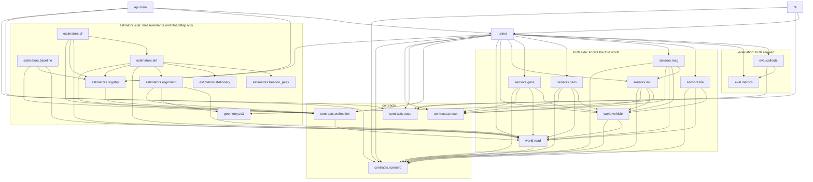

# Study notes

A reading guide for one day of study. It complements [CODE_TOUR.md](CODE_TOUR.md) (where every part lives, recipes, line
references) and does not repeat it. Numbers like `ekf.py:118` are line numbers at the time of writing (commit `8e3887f`);
use `grep -n` if they drift.

Contents: 1 Commit map, 2 One request end to end, 3 Dependency map, 4 UI inventory, 5 Complexity hotspots, 6 Exercises.

---

## 1. Commit map

57 commits. Hash, what it did and why, main files. Order is chronological inside each phase, newest last. Commits that only
touch AI log notes or the project setup are grouped into one line.

### Phase 0: setup and contracts

| Hash | What and why | Main files |
|---|---|---|
| `70fee33` | T0.0: the working rules (CLAUDE.md), the task plan (PLAN.md) and Claude Code settings. Everything later follows these. | `CLAUDE.md`, `PLAN.md` |
| `9532114` | T0.1: empty skeleton with the `sim/` package, FastAPI health endpoint, CLI stub, web app from Vite, Makefile. | `pyproject.toml`, `Makefile`, `sim/api/main.py`, `web/` |
| `ab1c334` | T0.1: local setup notes, gitignore, first AI log. | `.gitignore`, `docs/AI_LOG.md` |
| `ce1bfa5` | T0.3: the contracts (data shapes between modules) and the numbered assumptions, written before any code. | `docs/CONTRACTS.md`, `docs/ASSUMPTIONS.md` |

### Phase 1: data models

| Hash | What and why | Main files |
|---|---|---|
| `2803b3f` | T1.1: `Scenario` Pydantic model with range checks and `extra="forbid"`, so a typo in a JSON file is an error. | `contracts/scenario.py`, `test_scenario.py` |
| `549c3be`, `8dc2df7` | AI log note; "one session per phase" rule in CLAUDE.md. | docs |
| `e84e8db` | T1.2: columnar `Trace` model, JSON io and `decimate` (the UI does not need 100 Hz). | `contracts/trace.py` |
| `fa53d7f` | AI log note. | docs |
| `3aaf7a9` | T1.3: `Measurement`/`Estimate` types and the estimator registry (`@register`); process fixes in CLAUDE.md. | `contracts/estimation.py`, `estimators/registry.py` |

### Phase 2: the world

| Hash | What and why | Main files |
|---|---|---|
| `21ccfce` | T2.1: road geometry (arcs and straights to a centerline) and `RoadMap`, the only thing about the world an estimator may see. | `world/road.py` |
| `1b73335` | T2.2: vehicle motion along the road (cruise, ramp, stop, stop-and-go), producing true `s`, `v`, `a`, yaw, pitch. | `world/vehicle.py` |
| `bd46934`, `06cc4a0` | T2.3: several vehicles with a minimum following gap; the follower's braking is recorded as A13. | `world/vehicle.py` |

### Phase 3: sensors (the truth side)

| Hash | What and why | Main files |
|---|---|---|
| `2977e71`, `23d8889` | T3.1: sensor presets (flagship and budget phone) where every value carries a `source`. | `presets/*.json` |
| `481b7cb` | T3.2: IMU model: noise, bias, vibration, phone mount, handling events. | `sensors/imu.py`, `contracts/preset.py` |
| `5b0bdc7` | T3.3: GNSS with portal degradation, outages, bad fixes. | `sensors/gnss.py` |
| `96838d1` | T3.4: barometer with the portal pressure step and fan noise; GNSS `h_acc` as radial 68%. | `sensors/baro.py` |
| `3d4c93f`, `4ad9b74` | T3.5: magnetometer with tunnel disturbance; CR1 sets the disturbance to zero outside tunnels. | `sensors/mag.py` |
| `78bee8b` | T3.6: BLE beacon RSSI model. | `sensors/ble.py` |

### Phase 4: runner and scenarios

| Hash | What and why | Main files |
|---|---|---|
| `c82ff48` | T4.1: `run_scenario` and the CLI; per-vehicle, per-sensor seeded generators (`SeedSequence.spawn`). | `runner.py`, `cli.py` |
| `ddfa1a7`, `f2b212d` | T4.2: the scenario library (ten new files; 13 with the later hand-held ones) and a smoke test that runs all of them. | `scenarios/*.json` |
| `37c3885` | T4.2-CR1: drop the convoy scenario (one vehicle is enough for the demo). | `scenarios/` |

### Phase 5: first estimator and evaluation

| Hash | What and why | Main files |
|---|---|---|
| `a3d8b86`, `041d604` | T5.1: baseline estimator (last GNSS speed, dead reckoning in the tunnel); CR1 documents speed jitter. | `estimators/baseline.py` |
| `81e64af` | T5.2: metrics (in-tunnel RMSE, exit error, consistency). | `eval/metrics.py` |
| `fd72020` | T5.3: callout logic ("exit in 500/200/0 m" fires when `s + k*sigma` reaches the distance). | `eval/callouts.py` |

### Phase 6: API

| Hash | What and why | Main files |
|---|---|---|
| `2e979aa` | T6.1: FastAPI endpoints for scenarios, presets, estimators and simulate. | `api/main.py` |
| `385b934` | T6.1-CR1: decimate truth in the response too (the payload was too large). | `contracts/trace.py` |

### Phase 7: UI

| Hash | What and why | Main files |
|---|---|---|
| `cabbb42` | T7.1: app skeleton, reducer state, `api.js`, toolbar, panel. | `App.jsx`, `state.js`, `api.js` |
| `de9373f`, `46329b7` | T7.2: map view (SVG); CR1 fixes a mount crash and adds error boundaries. | `MapView.jsx`, `MapStatic.jsx`, `MapDynamic.jsx`, `ErrorBoundary.jsx` |
| `340d131` | T7.3: elevation profile. | `ElevationProfile.jsx` |
| `465fe77` | T7.4: playback (time cursor, speed, keyboard). | `usePlayback.js`, `Timeline.jsx` |
| `f7e5ad3` | T7.5: sensor charts. | `SensorCharts.jsx`, `sensorSeries.js` |
| `836eaa5` | T7.6: error chart with ±2σ band and callout lines; shared x geometry. | `ErrorChart.jsx`, `ChartStack.jsx` |
| `6bf4f56` | T7.7: scenario editor: sliders, JSON editor, Save as. | `Controls.jsx`, `JsonEditor.jsx`, `scenarioEdits.js` |
| `ae53653` | T7.8: estimator picker with editable params, metrics table. | `EstimatorPicker.jsx`, `MetricsTable.jsx` |

### Phase 8: estimators (T8.x are not in numeric order: the phone-handling fix came late)

| Hash | What and why | Main files |
|---|---|---|
| `26041e8` | T3.2-CR1: make phone handling physically consistent in IMU and magnetometer, two new hand-held scenarios. Needed before alignment could be tested. | `sensors/imu.py`, `sensors/mag.py` |
| `53a8dc5` | T8.1: alignment: find gravity and driving direction from the IMU, detect handling. | `estimators/alignment.py`, `geometry/so3.py` |
| `59dcc96`, `80e8609` | T8.1-CR1/CR2: tilt fusion after a put-back; no estimator-derived acceleration in the gravity window. | `alignment.py` |
| `c7df846` | T8.2: save the EKF design note first (the task rule). | `docs/design/T8.2_ekf.md` |
| `f774a09`, `978d893` | T8.2: the EKF `[s, v, b]`, then with the mount yaw state (first commit says acceptance tests pending). | `estimators/ekf.py` |
| `378c847` | T8.2-CR1: yaw error as a consider state; acceleration trust rule. | `ekf.py` |
| `da4c1f8` | DOC1: this repo's code tour and the explainability rule. | `docs/CODE_TOUR.md`, `CLAUDE.md` |
| `20ebf2b`, `1f7f34d` | T8.3: stationary detector and ZUPT (`ekf_zupt`); CR1 sets limits and working rules. | `stationary.py`, `ekf.py` |
| `be14223` | T8.6: exit safeguard (gate reset) and display smoothing (`display_s`). | `ekf.py` |
| `eb235f9` | T8.5: beacon pass detection and update; beacons became map knowledge (`RoadMap.beacons`). | `beacon_peak.py`, `ekf.py`, `road.py`, `trace.py` |
| `8c78f46`, `705adfb` | T8.4: save the particle-filter design note, then `pf` (wraps `ekf_zupt`, map matching). | `estimators/pf.py` |
| `8e3887f` | T8.4-CR1: particle speed spread follows EKF `P_vv`, barometer weighted every 10 s, `use_baro` switch with a checkbox in the UI and `bool` constraints. | `pf.py`, `registry.py`, `EstimatorPicker.jsx`, `CONTRACTS.md` |
| (next) | T8.4-CR2: barometer matching removed from `pf` (curvature only); the barometer stays a sensor and chart. Reason: its benefit in tunnels is uncertain and single runs showed no clear gain. Hash: see `git log`. | `pf.py`, `test_pf.py` |

Reading tip: `git show --stat <hash>` for one commit; the CR commits are the best place to see why a design decision changed.

---

## 2. One request end to end

You press **Run**. This is every hop, with `file:function`. Python line numbers refer to `runner.py` unless noted.

**Browser, before the request**

1. `web/src/components/Toolbar.jsx` (button, `:20`) calls `onRun`, which is `run` in `web/src/App.jsx:57`.
2. `App.jsx: runWith` (`:47`) reads the freshest state from `latest.current`, takes a new `runId`, and dispatches `run_start`
   (`state.js: reducer`, `:58`: `loading = true`, so the button disables and the spinner shows).
3. It builds `chosen`, `{estimator_id: params}` for the selected estimators, and calls `api.js: simulate` (`:37`).
4. `api.js: request` (`:12`) does `fetch('/api/simulate', POST)`. The body is `{scenario, estimators, decimate_hz: 10, callout_k}`.
   Vite's dev proxy (`web/vite.config.js`) forwards `/api` to `localhost:8000`.

**API**

5. `sim/api/main.py: simulate` (`:82`). FastAPI first parses the body into `SimulateRequest` (`:28`), which makes
   `contracts/scenario.py: Scenario` validate every field (ranges, `extra="forbid"`, vehicles on the road). A bad file stops
   here with a 422 that names the field.
6. `main.simulate` checks the estimator ids against the registry, then `registry.py: validate_params` (`:46`) checks each
   parameter name and range. Errors become 422.
7. `main.simulate` calls `runner.py: run_scenario` (`:128`).

**Runner: truth side**

8. `world/road.py: RoadMap(scenario.road)` builds the centerline (`build_centerline`, `:24`); with beacons enabled,
   `sensors/ble.py: beacon_positions` fills `road_map.beacons` (`runner.py:135`).
9. `np.random.SeedSequence(seed).spawn(1 + n_vehicles)` (`:137`): one stream for motion, one per vehicle. Same seed, same trace.
10. `world/vehicle.py: simulate_vehicles` (`:138`) gives true `t, s, v, a, yaw, pitch` at the IMU rate.
11. Per vehicle (`:140`): `contracts/preset.py: load_preset` reads the sensor numbers; then `sensors/imu.py: generate_imu`,
    `gnss.py: generate_gnss`, `baro.py: generate_baro`, `mag.py: generate_mag`, `ble.py: generate_ble` (`:144-153`), each with its
    own seeded generator. The result is columns of measurements, which also go into the trace (`Measurements`, `:155`).

**Runner: estimator side**

12. `_run_estimators` (`:89`) gets only `road_map`, the sensor columns and the times. `_merged` (`:72`) turns the columns into
    one list of `Measurement` objects ordered by time. Truth is not passed.
13. For each requested id: `registry.get_estimator(key)()`, `est.reset(road_map, params)`, then for every output time
    (`rates.output`): feed all measurements with `m.t <= t_out` through `est.update(m)` (timed with `perf_counter_ns`), then
    call `est.estimate(t_out)` and append `s, v, sigma_s, display_s, mode` to `EstimateColumns` (`:108-120`).
    Example path for `ekf_zupt`: `ekf.py: update` -> `_imu` (aligner, predict, ZUPT) / `_gnss` (gated update) / `_ble` (beacons).

**Runner: evaluation (truth is allowed here)**

14. `_truth` (`:53`) builds the truth columns; `eval/callouts.py: compute_callouts` fires callouts from the estimate only;
    `eval/metrics.py: compute_metrics` compares estimate to truth (RMSE in tunnel, exit errors, consistency, error series);
    `ideal_times` and `missed_callouts` add the reference lines (`:160-176`).
15. `VehicleTrace` is assembled with truth, measurements, events, estimates, callouts, metrics; `Trace` adds `_map_columns` (`:181`).

**Back in the API and over the wire**

16. `main.simulate` calls `contracts/trace.py: decimate` (`:147`, truth, IMU, baro and mag to 10 Hz) and
    `model_dump_json(exclude_none=True)` (`:97`). Missing sensors become absent fields, never nulls.

**Browser, after the response**

17. `api.js: request` returns `res.json()`; `App.runWith` dispatches `run_done` (`state.js:61`). It is ignored if a newer
    `runId` exists (so a slow old run cannot overwrite a newer one).
18. `state.trace` changes, so `App` recomputes `duration` (`lib/trace.js: vehicleDuration`) and `usePlayback` resets `t`.
    Error boundaries re-arm because their `resetKey` is the trace.
19. Views read the trace (only `vehicles[0]` is shown): `MapView` -> `MapStatic` (road, tunnels, exits, drawn once) and
    `MapDynamic` (car and estimate markers at time `t`, `lib/interp.js: interpAt`); `ElevationProfile`; `Timeline` (tunnel
    bands from `events`); `MetricsTable` and `Panel` (from `vehicle.metrics`); `ErrorChart` (`buildRows`, `:14`, uses
    `metrics[id].error` and `sigma_s`); `SensorCharts` (`sensorSeries.js: buildCharts`).

Two details worth remembering for the interview: the browser never computes an error itself (the runner does, with truth);
and the only time-dependent drawing is `MapDynamic`, the elevation markers and the shared cursor, so playback stays cheap.

---

## 3. Dependency map

Arrows read "imports". Only `sim/` modules are listed. Generated from the import lines of the files.

How to read it:

- **Truth side** (`world/`, `sensors/`): knows the real position, speed and noise models. It makes the data.
- **Estimator side** (`estimators/`, plus `geometry.so3`): sees `Measurement`, `Estimate` and `RoadMap` only. It never imports
  `sensors`, `eval`, `runner` or `world.vehicle`. `tests/test_runner.py::test_estimator_sees_only_measurements_in_time_order`
  enforces it by parsing the import lines.
- **Shared on both sides**: `contracts/*` (data shapes) and `world.road` (the map: geometry, tunnels, exits, speed limits,
  beacons). The map is knowledge, not truth.
- **Evaluation** (`eval/`): reads estimates and truth after the run. Estimators never import it.
- **Only `runner.py`** touches both sides. That single file is where the truth-isolation rule is kept.
- Quirk: `sensors.mag` imports `sensors.imu` (for the shared `MountPath`). `eval.callouts` imports a private helper
  `_cross_t` from `eval.metrics`.

---

## 4. UI inventory

Rating for the interview demo: **core** (the story breaks without it), **useful** (helps the story, keep if time allows),
**optional** (can be dropped without hurting the story). The ratings are my honest opinion, not a rule.

### Toolbar and playback

| Element | What it does | File | Rating |
|---|---|---|---|
| Scenario select | Loads a scenario by id from `/api/scenarios`. | `Toolbar.jsx`, `App.jsx` | core |
| **Run** button | Sends the current scenario and chosen estimators. | `Toolbar.jsx`, `App.jsx:runWith` | core |
| Spinner and description | "Simulating…" and the scenario's one-line text. | `Toolbar.jsx` | useful |
| Error box | Shows API errors (field names from 422). | `Toolbar.jsx` | core |
| Play / pause, speed select (1-20x), time slider | Moves the shared time cursor. | `Timeline.jsx`, `usePlayback.js` | core |
| "T1 entry" / "T1 exit" jump buttons | Seek to 5 s before the event. | `Timeline.jsx` | useful |
| Keyboard: Space, arrows, Shift+arrows | Play/pause and seek. | `usePlayback.js` | optional |

### Left column (views)

| View | What it shows | File | Rating |
|---|---|---|---|
| Map (SVG) | Road, tunnels, exits, truth car, each estimator with ±2σ bar, recent GNSS fixes. | `MapView.jsx`, `MapStatic.jsx`, `MapDynamic.jsx` | core |
| Map pan, wheel zoom, scale bar | Navigation of the map. | `MapView.jsx`, `ScaleBar.jsx` | optional |
| Map "Follow car" checkbox | Keeps the car centered (1 km window). | `MapView.jsx` | useful |
| Elevation profile | Road height with markers; the barometer's view of the dip; no estimator uses the barometer since T8.4-CR2. | `ElevationProfile.jsx` | useful |
| Metrics table | Per estimator: in-tunnel RMSE, exit errors, consistency, callout timing, compute time; best per column. | `MetricsTable.jsx` | core |
| Error chart | Signed error vs time, ±2σ band, callout fire times and ideal lines. | `ErrorChart.jsx` | core |
| Error chart range select (auto, ±50 m, ±200 m) | Y scale. | `ErrorChart.jsx` | optional |
| Sensor charts + checkboxes | IMU, baro, mag, GNSS, BLE series on the same time axis. | `SensorCharts.jsx`, `sensorSeries.js` | useful |
| Chart stack click-to-seek and shared cursor | Click any chart to move time. | `ChartStack.jsx` | useful |

### Right column

| Control | What it does | File | Rating |
|---|---|---|---|
| Auto-run checkbox | Re-runs after each committed edit. | `Controls.jsx`, `App.jsx` | useful |
| Edit JSON | Full scenario in a text box; error with line and column. | `JsonEditor.jsx` | useful |
| Reset to saved | Reload the scenario from disk. | `Controls.jsx` | optional |
| Save as… | Writes a new scenario file (never overwrites). | `Controls.jsx`, `api/main.py:save_scenario` | useful |
| Tunnel length slider | Resizes the first tunnel and extends the road. | `Controls.jsx`, `scenarioEdits.js:setTunnelLength` | core |
| Exit position slider | Moves the first exit. | `Controls.jsx` | core |
| Cruise speed slider | Initial speed. | `Controls.jsx` | useful |
| "Add 60 s stop in tunnel" | Adds a stop for the ZUPT story. | `scenarioEdits.js:addStopInTunnel` | useful |
| Phone preset select | Flagship vs budget phone. | `Controls.jsx` | useful |
| Mount pitch slider | Phone tilt in the mount. | `Controls.jsx` | optional |
| Fan pressure noise slider | Barometer disturbance (A22). | `Controls.jsx` | optional (it shows how noisy the barometer can be) |
| Beacons checkbox, beacon spacing slider | BLE beacons in the tunnel. | `Controls.jsx` | useful (spacing: optional) |
| Seed input, New seed | Different noise realization. | `Controls.jsx` | useful |
| Callout k slider | How early callouts fire (`s + k*sigma`). | `Controls.jsx` | useful |
| Methods list: checkbox per estimator | Which estimators run. | `EstimatorPicker.jsx` | core |
| Params (number inputs, bool checkbox, Reset) | Edit estimator parameters. | `EstimatorPicker.jsx` | useful (the ZUPT threshold demo needss it) |
| Results panel | Duration, RMSE and exit error per estimator, "Outdated" banner. | `Panel.jsx` | useful (repeats the metrics table) |

### Features you could drop

- **Results panel** (`Panel.jsx`): its numbers are a subset of the metrics table. Keep only the "Outdated" banner, or move
  that into the toolbar.
- **Map pan/zoom and scale bar** (`MapView.jsx` pointer and wheel code, `ScaleBar.jsx`): "Follow car" covers the demo.
- **Error chart range select**, **Reset to saved**, **Mount pitch**, **Beacon spacing**, **keyboard shortcuts**: small, harmless,
  but not needed for the story.
- **ErrorBoundary around every view**: invisible when nothing breaks; do not drop, but do not explain it either.
- **Finding, not a feature:** `display_s` (the smoothed position of T8.6) is in the trace but **no file under `web/src` reads
  it**. The map and error chart draw the raw `s`. Either draw it, or be ready to say that it is a metric (the display
  jitter metrics use it) and not yet a visual.

---

## 5. Complexity hotspots

Longest functions (counted from the `def` or `function` line to the last line), measured with Python `ast`; JavaScript
counted by hand. Counts include docstrings and comments.

| # | Function | Lines | What it does |
|---|---|---|---|
| 1 | `web/src/App.jsx: App` | 130 | The hub: reducer, effects that load presets/estimators/scenarios, run logic with stale-run protection, edit handlers, the page layout. |
| 2 | `web/src/components/MapView.jsx: MapView` | 112 | Map component: SVG viewport, zoom with the wheel, drag to pan, follow mode, layout of static and dynamic layers. |
| 3 | `sim/estimators/alignment.py: process_imu` (`:327`) | 65 | Per IMU sample: handling detection, gravity window, tilt fusion, driving-direction solve; the state machine of the aligner. |
| 4 | `sim/runner.py: run_scenario` (`:128`) | 54 | Whole pipeline for all vehicles: map, seeds, motion, five sensors, estimators, truth, callouts, metrics, trace assembly. |
| 5 | `sim/estimators/ekf.py: _imu` (`:118`) | 48 | EKF IMU step: aligner output, predict (state and covariance), consider-state yaw error, ZUPT call, gate-reset bookkeeping. |
| 6 | `sim/estimators/alignment.py: _gravity_step` (`:286`) | 39 | Averages the specific force over a window and decides whether gravity is stable enough to trust. |
| 7 | `sim/eval/metrics.py: compute_metrics` (`:34`) | 38 | RMSE in tunnels, exit errors, consistency, display jitter, error series. |
| 8 | `sim/sensors/gnss.py: generate_gnss` (`:51`) | 37 | GNSS fixes with noise, portal degradation, outages and bad fixes. |
| 9 | `sim/runner.py: _run_estimators` (`:89`) | 37 | The causal feeding loop (see section 2, step 13). |
| 10 | `sim/world/vehicle.py: simulate_vehicle` (`:175`) | 36 | Integrates one vehicle's speed profile along the road. |

Next in line: `alignment.py: _solve` (35), `road.py: build_centerline` (34), `Controls.jsx: Controls` (54, but flat JSX).
Biggest files: `alignment.py` 391 lines, `ekf.py` 289, `vehicle.py` 228, `scenario.py` 215. For an interview, the EKF and the aligner
are the two files you must be able to walk through line by line.

### Simplification candidates

My estimates; none of them is applied. Effort: S under 1 h, M 1-3 h, L more. Risk: what could break.

| Candidate | Why | Effort | Risk |
|---|---|---|---|
| Split `process_imu` into 2-3 small methods (handling, gravity, solve) | Longest estimator function; hard to explain at once. | M | Medium: the aligner has subtle timing (staging 0.3 s, detection 0.2 s); `test_alignment.py` and the EKF tests would catch regressions only partly. |
| Split `App` into hooks (`useScenarioLoader`, `useRun`) and a layout component | 130 lines mixing data flow and layout. | M | Low-medium: the `latest` ref trick must survive; checked only manually in the browser. |
| Extract the pan/zoom code out of `MapView` into a `useMapViewport` hook (or drop pan/zoom) | 112 lines, three jobs. | M (S if dropped) | Low |
| Delete `Panel.jsx` results and keep the banner in `Toolbar` | Duplicates the metrics table. | S | Low |
| Split `run_scenario` into `_simulate_vehicle` (sensors) and `_evaluate_vehicle` (callouts, metrics) | The only function that touches both sides; two jobs. | S-M | Low: tests cover the trace, but keep `KINDS` order and the rng spawn order. |
| `ekf._imu`: move the yaw consider-state block into its own method | 48 lines with five concerns. | S | Medium: numerically sensitive; run the three EKF acceptance scenarios before and after. |
| Move `_cross_t` from `metrics.py` to a shared helper (it is imported privately by `callouts.py`) | A private name used across modules. | S | Low |
| Draw `display_s` in the UI or remove it from `EstimateColumns` | Today it is produced and shipped but never drawn. | S (draw) | Low; removing touches contracts and needs approval. |

---

## 6. Hands-on exercises

Setup once: `pip install -q -e '.[dev]'`, `make dev` in one terminal (API on port 8000, UI on port 5173; both reload on
file changes), open http://localhost:5173. Run tests with `python -m pytest -q` (52 should pass). Each exercise has a revert
step; do it before the next one (`git checkout -- <file>`).

### 1. Change the ZUPT threshold

- **Steps:** select `stop_and_go_3km`. In Methods, open Params of "EKF + ZUPT", set `zupt_acc_std` from `0.05` to `0.0005`
  (press Enter or Tab; auto-run re-runs).
- **File to read:** `sim/estimators/stationary.py` (the detector compares the standard deviation of |a| over a 1 s window with
  this value) and the `zupt_acc_std` default in `sim/estimators/ekf.py` (`EkfZuptEstimator.default_params`).
- **Expected:** with a threshold that small the detector never says "stationary", so ZUPT never fires and "EKF + ZUPT" gives the
  same numbers as "EKF". I checked: in-tunnel RMSE goes from 59.8 m (default) to 51.9 m, identical to plain `ekf` (51.9 m).
  So on this scenario the default ZUPT costs about 8 m; a good interview question to prepare an answer for.
- **Revert:** press Reset in the Params box.

### 2. Why the particle filter does not use the barometer

- **Steps:** select `undersea_3km_dip`, Run, and look at the barometer chart in the sensor charts: the pressure step at the
  tunnel entry and the slow change over the dip. Then drag "Fan pressure noise" from 8 to 50 Pa and look again.
- **File to read:** `docs/design/T8.4_pf.md` addendum "Barometer removed", `sim/sensors/baro.py` (the model, A21, A22).
- **Expected:** the dip is visible in the pressure trace, and the fan noise at 50 Pa buries a good part of it. Real ventilation
  and passing vehicles are unknown and could be that large, which is why the estimators no longer use the barometer
  (T8.4-CR2). Nothing in the metrics changes with this slider, because no estimator reads the barometer.

### 3. Add a scenario from the UI and save it

- **Steps:** select `curved_2km`; drag "Tunnel length" to 1.5 km, "Cruise speed" to 90 km/h; click **Save as…**, type
  `my_curved_90`, **Save**.
- **File to read:** `web/src/components/Controls.jsx: SaveAs`, `sim/api/main.py: save_scenario` (`:59`), `web/src/lib/scenarioEdits.js`.
- **Expected:** the picker now lists `my_curved_90`, the file `scenarios/my_curved_90.json` exists, saving it again says
  "already exists" (409; the file mode is `"x"`).
- **Careful:** `python -m pytest -q` will now fail: `tests/test_api.py` and `tests/test_scenarios.py` count the scenarios.
  Either delete the file (`rm scenarios/my_curved_90.json`) or update both numbers as in the CODE_TOUR recipe "add a scenario".

### 4. Add a new parameter to the baseline

- **Steps:** in `sim/estimators/baseline.py` add `"demo_gain": 1.0` to `default_params` (line 19) and
  `"demo_gain": {"type": "float", "gt": 0}` to `constraints` (line 22). Read it in `reset` (like `gap_timeout_s`, `:32-35`) and
  multiply the dead-reckoning speed by it in `update`/`estimate` where the speed is used.
- **Expected:** `uvicorn --reload` restarts; reload the page. The baseline's Params box has a new number input `demo_gain`.
  Set `1.1` and Run: the baseline's tunnel error should grow clearly (its speed is 10% too high; I did not measure the size). Type `0` and the input
  shows "must be > 0" and does not send. Send `0` from the API anyway (`curl`) and you get a 422 naming `demo_gain`.
- **File to read:** `sim/estimators/registry.py: validate_params`, `web/src/components/EstimatorPicker.jsx: ParamInput`.
- **Revert:** `git checkout -- sim/estimators/baseline.py`.

### 5. Break the scenario JSON and read the error

- **Steps:** click **Edit JSON**. (a) Delete a closing brace and **Apply**: the editor shows the JSON error with line and column
  (`JsonEditor.jsx: describe`). (b) Fix it, then add `"fan_pressure_nope": 1` inside `tunnel_env`, Apply: the run fails and
  the red box says `scenario.tunnel_env.fan_pressure_nope: Extra inputs are not permitted`. (c) Change `"seed": 7` to
  `"seed": "abc"`: `scenario.seed: Input should be a valid integer, unable to parse string as an integer`.
- **Files to read:** `web/src/api.js: formatDetail` (`:3`), `sim/contracts/scenario.py` (`_Model` has `extra="forbid"`, `:10`).
- **Expected:** the old trace stays on screen and is marked "Outdated"; nothing is saved. Messages above are what the API
  returned when I tried (b) and (c) with the test client.

### 6. Change callout k and watch the error chart

- **Steps:** select `curved_5km_exit_inside`, Run. Move "Callout k" from `1.0` to `0` and to `3.0`. The slider commits on release,
  and auto-run re-runs.
- **File to read:** `sim/eval/callouts.py: fire_times` (`:14`, fires when `s + k*sigma >= exit_s - d`),
  `web/src/components/ErrorChart.jsx: callouts` (`:33`).
- **Expected:** with `k=0` the vertical callout lines of each estimator sit at the moment the estimate itself reaches 500, 200
  and 0 m; with `k=3` they move earlier, by about 3 times the uncertainty, so an uncertain estimator warns early. The dashed truth
  lines (ideal times) do not move. The metrics table's callout columns change accordingly.

### 7. Add a unit test for a parameter you added (tests)

- **Steps:** after exercise 4, add to `tests/test_estimators.py` a test that
  `registry.validate_params("baseline", {"demo_gain": 0})` raises `ValueError`. Run `python -m pytest -q tests/test_estimators.py`.
- **Expected:** it passes (53 tests overall while it exists; remove it and the parameter to return to 52).
  Remove the parameter: the test fails with `unknown parameter 'demo_gain'`.

### 8. Follow one measurement through the EKF

- **Steps:** in a Python shell:
  `from sim.contracts.scenario import load_scenario; from sim.runner import run_scenario`, then
  `tr = run_scenario(load_scenario("scenarios/curved_2km.json"), {"ekf_zupt": {}})`.
  Print `tr.vehicles[0].metrics["ekf_zupt"]["rmse_in_tunnel_m"]` and
  `tr.vehicles[0].estimates["ekf_zupt"].mode` around the tunnel entry (the mode switches to `dead_reckoning` after the GNSS timeout).
- **File to read:** `ekf.py: _gnss` (`:214`), `ekf.py: estimate`, `runner.py:_run_estimators`.
- **Expected:** RMSE in the tunnel 41.1 m for this scenario and seed (the number from the T8.4 table); the mode column should leave `gnss` for `dead_reckoning` shortly after the last fix at the portal (`gnss_timeout_s`, 1.5 s;
  `ekf.py: estimate`, `:267`). I did not print it; check it yourself.
