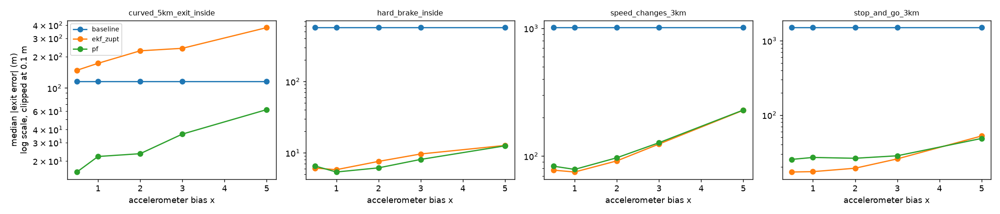
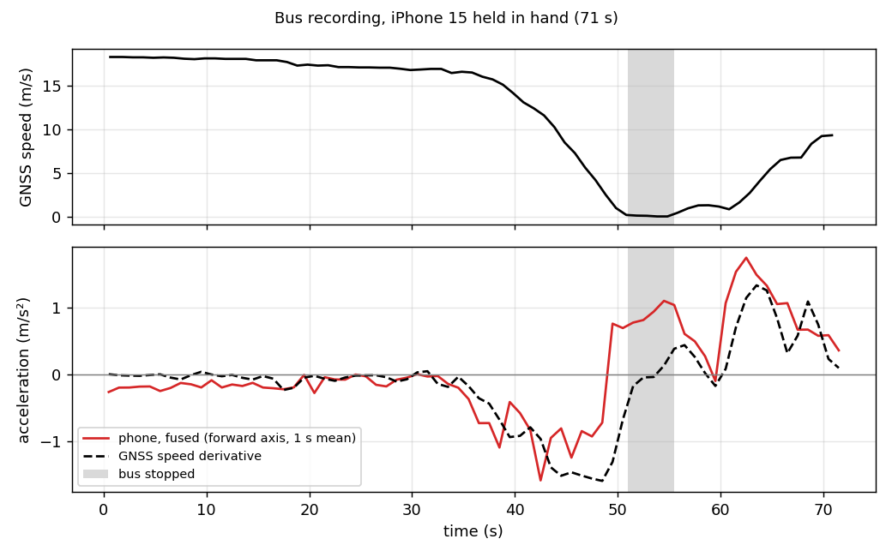

# Through the Tunnel: positioning a car in a GNSS-denied tunnel

*Write-up for the Pointr case study. Code, scenarios and every number below are in this repository; the results tables are
regenerated with `make montecarlo` and `make figures`.*

## 1. Problem and key insight

A driver follows turn-by-turn directions; the road enters a single-lane tunnel 0.5 to 5 km long and GNSS is gone for
minutes. The app still has to show where the car is, call out an exit inside the tunnel at the right moment, and recover
cleanly when the car comes out. Inside the tunnel the phone still has its IMU (accelerometer, gyroscope), a barometer, a
magnetometer and, in some tunnels, Bluetooth beacons.

The insight that shapes everything else: **inside a single-lane tunnel on a known route, the problem is one-dimensional.**
The car cannot overtake and the route is known from navigation (A1), and the map gives the centerline, curvature and grade
(A2), so the only unknown that matters is the distance travelled along the road, `s`. Every measurement is turned into
information about `s` or its derivatives: GNSS fixes are projected onto the map, a beacon pass is a known `s`, a curve is a
place where the gyro must see a known yaw rate. This keeps the estimators small (three states instead of a 15-state inertial
navigation system) and makes every term explainable.

## 2. Approach: layers on top of each other

Each method adds one source of information to the previous one, so the contribution of each layer can be measured.

1. **Baseline.** Keep the last GNSS speed and extrapolate at constant speed; the uncertainty grows linearly. This is what a
   navigation app does without inertial sensors.
2. **Alignment** (`alignment.py`). Before the IMU is useful, the phone's axes have to be related to the car's. On the open
   road, with GNSS, the aligner finds "up" from the mean accelerometer, the gyro bias from straight driving and the forward
   axis from a Procrustes fit between the measured acceleration and the GNSS speed change. It detects the phone being handled
   from the gyro alone and re-aligns after the put-back.
3. **EKF** (`ekf.py`). State `[s, v, b]` (position, speed, accelerometer offset) plus the remaining mount-yaw error as a
   consider state. The IMU drives the prediction; GNSS, projected onto the map, corrects position and speed. Measurements are
   checked with a chi-square gate, and five rejections in a row re-initialise the filter from the fix (for the exit, where
   the filter may be far off). A trust rule switches to a constant-speed model when the offset is too uncertain and there is
   no GNSS, so a badly calibrated accelerometer cannot do more harm than the baseline.
4. **ZUPT.** When the vibration of the accelerometer and gyro magnitudes drops below a threshold, the car is standing:
   `v = 0` is applied as a measurement, and the mean acceleration measures the offset `b` directly.
5. **Beacons.** A beacon pass is found as the peak of the smoothed RSSI and becomes a position measurement at the beacon.
6. **Particle filter** (`pf.py`). Curves are map features: in a curve the gyro must see `v · curvature(s)`. This makes the
   belief about `s` multi-modal (two similar curves can both match), which a Gaussian filter cannot represent, so a particle
   filter runs on top of the EKF and weights particles by how well their expected yaw rate matches the gyro. On a straight
   road it does nothing.

**Recovering at the exit.** The first fixes after a portal are poor (A19). The gate judges each fix against the filter's
own uncertainty, which is large after minutes without GNSS, so these fixes are accepted with the large accuracy they
report and their damage stays small. If the filter is confident but wrong, five rejected fixes in a row re-initialise it
from GNSS. The position shown on the map moves toward the estimate at a bounded speed, so the arrow never jumps; callouts
use the unsmoothed estimate.

**Callouts.** The exit is announced 500 m, 200 m and 0 m before it, at the first moment when `s + k·σ ≥ exit − d`. Using the
upper edge of the belief makes the rule conservative: when the estimate is uncertain the callout comes early rather than
late, because a late callout is the failure a driver cannot recover from.

## 3. Assumptions that matter most

All assumptions are numbered in [`docs/ASSUMPTIONS.md`](ASSUMPTIONS.md), each with its effect; code that depends on one
cites it (`# A17`). The ones that shape the results:

- **A1 single lane, known route:** makes the problem one-dimensional. With lane changes or an unknown route, the filter would
  need a lateral state and the map matching would have to consider several roads.
- **A2 accurate map (< 2 m):** the particle filter trusts the curvature; map errors would directly hurt it.
- **A3 phone in a mount:** taking it out is modelled as separate handling scenarios.
- **A4 at least 60 s of GNSS before the tunnel:** the mount is calibrated in this window. With less, the EKF falls back to
  constant speed in the tunnel.
- **A6 no positioning inside the tunnel** (no GNSS repeaters, cellular or Wi-Fi positioning); beacons only where a
  scenario enables them (A7).
- **A9 the callout point is where the exit begins.**
- **A14, A16 sensor quality:** biases and drifts derived from datasheets; the budget phone is the flagship scaled by 2–4×.
  The bias sweep (6.2) tests how much the conclusions depend on this.
- **A17 vibration:** chosen so that standing and moving are separable; stop detection depends on it, and it is not yet
  validated with a mounted phone (section 8).
- **A8 delay-free, synchronised sensors:** optimistic for BLE beacons on real phones.
- **No vehicle speed** (OBD, CarPlay, Android Auto) is assumed (A5); it is the obvious upgrade (section 9).

## 4. What is simulated and how

Everything runs on simulated data, built so that the estimators never see the truth (truth isolation is enforced in
`sim/runner.py`; metrics are computed on the truth side only).

- **World.** A road map at 1 m resolution (curvature, grade, tunnels, exits, beacons) and a vehicle that follows a driving
  plan: cruise, speed changes, stops, traffic. Motion is jerk-limited with passenger-comfort accelerations (A11); while
  cruising, the driver's speed wanders by a few km/h with 10–50 s periods (A27).
- **Sensors.** A 100 Hz phone IMU with a bias and a temperature-driven bias drift derived from datasheet coefficients (A14),
  vibration that grows with speed (A17), a mount orientation unknown to the estimator, and handling events in which the phone
  is picked up and put back at a new angle. GNSS at 1 Hz with time-correlated errors (A15), degradation near portals (A19) and
  nothing inside the tunnel (A6). Barometer, magnetometer and BLE beacons are simulated as well (A20–A26).
- **Phones.** A flagship preset from datasheets and a budget preset with 2–4× worse sensors (A16).
- **Scenarios.** Fifteen scenarios, each testing one thing (`scenarios/README.md`). This write-up uses eight of them, one or
  two per question; the rest are in the full table (`docs/results/summary.md`).
- **The simulator.** A web app (FastAPI and React) runs a scenario and shows the true position next to each method's
  estimate, its uncertainty band, the sensor streams and the callouts; every scenario value and estimator parameter can be
  changed live, and a Monte Carlo panel runs 20 seeds of the current settings in about 30 s. The simulation core supports
  several cars in one tunnel (A10, A13), added through the scenario JSON; the evaluation scenarios use one car, because each
  car's phone is estimated independently, and the UI and metrics show the first car.
- **Determinism.** One seed per scenario run is split into one random stream per sensor, so the same seed reproduces a run
  exactly and changing one sensor never changes another sensor's noise.

The barometer is simulated but not used: tunnel ventilation and passing traffic change the pressure by amounts that are not
documented and may be far larger than the altitude signal a grade produces (A34). The magnetometer is not used either; steel
reinforcement and vehicles disturb it inside tunnels (A23).

## 5. How it is evaluated

Single runs are misleading: with one seed, EKF + ZUPT reached the exit of `speed_changes_3km` with a 45 m error; over 300
seeds the median is 88 m. Every number in this write-up therefore comes from Monte Carlo runs: **300 seeds** per scenario and
method for the main study, 50 for the side studies, 30 per point for the sweeps. A seed changes every random draw (sensor
noise, driver behaviour, traffic, GNSS errors).

Metrics: **exit error** (position error when the car leaves the tunnel; median and p90 of its absolute value), **in-tunnel
RMSE**, **consistency** (the share of tunnel samples where the true error is inside ±2σ; about 95% means the filter is honest
about its own uncertainty), **callout timing** (announcement time minus ideal time; negative is early) and **missed
callouts**.

## 6. Results

### 6.1 Main study (300 seeds)

Median (p90) absolute exit error in metres:

| Scenario | What it tests | Baseline | EKF | EKF + ZUPT | PF |
|---|---|---|---|---|---|
| `speed_changes_3km` | speed changes without stops | 1046 (1353) | 88 (235) | 88 (235) | 89 (238) |
| `stop_and_go_3km` | traffic with stops | 1500* (1500*) | 86 (835) | **18 (38)** | 19 (43) |
| `curved_5km_exit_inside` | longest outage, two curves | 109 (243) | 142 (354) | 142 (354) | **21 (53)** |
| `beacons_5km` | beacons every 400 m | 102 (250) | **3.3 (8.1)** | 3.3 (8.1) | 3.5 (7.9) |
| `budget_phone_5km` | 2–4× worse sensors | 112 (250) | 259 (630) | 259 (630) | **43 (106)** |
| `phone_in_hand_2min` | phone handled for 2 min | 100 (220) | 105 (258) | 105 (258) | **13 (31)** |
| `phone_in_hand_whole_trip` | no alignment possible | 96 (229) | 109 (242) | 109 (242) | 104 (241) |
| `twin_tunnels_short_gap` | short GNSS window | 32 (75) | 15 (35) | 15 (35) | 15 (35) |

\* Saturated: the estimate reached the end of the simulated road, so the true error is larger.

**No method wins everywhere; the physics of the scenario decides which one does.**

- **When speed changes, the accelerometer pays off.** The baseline assumes the last speed; the EKF follows the changes.
  `speed_changes_3km`: 1046 m → 88 m.
- **When the car stops, ZUPT pays off.** Without it the EKF has a heavy tail (p90 835 m in `stop_and_go_3km`); with it the
  median is 18 m and the p90 38 m.
- **When the map has features, the particle filter pays off.** Curves anchor the position: 142 m → 21 m in
  `curved_5km_exit_inside`, 259 m → 43 m with the budget phone, 105 m → 13 m when the phone is handled mid-tunnel. Beacons
  do the same for the EKF on a straight tunnel (3.3 m).
- **On a long, straight, constant-speed tunnel the constant-speed assumption is hard to beat.** If the car really keeps its
  speed, the baseline's model is the right one, and the accelerometer adds only its own drift (see 6.2).
- **When the phone is in the hand for the whole trip,** no method does better than the baseline: the accelerometer cannot
  be related to the car, and the filter falls back to constant speed, as designed.

**Callouts.** No callout was missed in any of the 18,000 runs. With the method that suits the scenario, the median timing
error is within about 2 s (e.g. `stop_and_go_3km` with EKF + ZUPT: −1.2 s at 500 m, p90 4.7 s; `curved_5km_exit_inside`
with the PF: −0.4 s). Errors are mostly negative, i.e. early, which is the intended effect of the `s + k·σ` rule.

**Recovery at the exit.** Recovery time is measured from the first GNSS fix after the exit until the error stays within
10 m. It is short for every method (median 1–2 s for the filters, 3 s for the baseline), but the methods recover very
differently on the map. The baseline's displayed position jumps by its whole exit error when the first fix arrives (median
largest jump 100–1400 m depending on the scenario), while for the EKF and the PF the median largest jump over the whole run
is 1–2 m. In `twin_tunnels_short_gap` the 200 m gap is often too short to recover before the second tunnel (16 of 300 runs
for the filters, 79 for the baseline).

**Consistency** is 90–99% for the EKF family and the PF in most scenarios. The exception is short tunnels: in a 0.5 km
tunnel the EKF is at 79%, i.e. somewhat over-confident.

**Cost.** The EKF needs about 50 µs per measurement and the PF about 1.4× that (measured under parallel load, so only the
ratio is meaningful), far below the 10 ms between IMU samples.

### 6.2 Sweeps: where the approach breaks

**Tunnel length** (straight tunnel, constant speed, 0.5–5 km, 30 seeds per point). The EKF beats the baseline up to 2 km
(2.5 m vs 13 m at 0.5 km, 19 m vs 43 m at 2 km), the two are about equal at 3 km, and at 5 km the baseline wins (89 m vs
167 m). An accelerometer offset turns into a position error that grows with t²; in a long tunnel without speed changes it
outgrows the small speed variations the accelerometer catches. The PF cannot help here: a straight road has no features.

**Accelerometer bias** (0.5–5× the simulated phone's bias, while the filter keeps assuming the original phone). This tests
how much the conclusions depend on the sensor assumptions.

- Errors grow, but the ranking does not change: at 5× the EKF is still 4× better than the baseline in `speed_changes_3km`
  (228 m vs 1012 m).
- Stops and map features limit the damage: `hard_brake_inside` goes from 6 m to 13 m, because ZUPT resets the speed.
- A better phone helps little: at 0.5× the errors are almost the same as at 1×, so the nominal bias is not the dominant
  error source.
- **The real cost is honesty.** A filter that assumes a better phone than it has becomes over-confident: consistency drops
  from 90% to 62% in `stop_and_go_3km` and from 96% to 72% in `speed_changes_3km`. Measuring the real phone's bias is
  therefore the first thing to do on real hardware.

### 6.3 What the Monte Carlo study found and fixed

The first 50-seed run showed three errors that all 50 seeds had on the same side, i.e. biases rather than bad luck:

| Finding | Cause | Fix | Before → after |
|---|---|---|---|
| EKF + ZUPT always behind after stops, over-confident, late callouts | The offset update at a stop was weighted with the driving-vibration noise (gain ≈ 2%), so stops taught the filter almost nothing; and the detector fired while the car still crept at 0.4–0.8 m/s, and the `v = 0` update dragged `s` back through the s–v correlation | Measure the noise from the stop window itself, gate the update, and let `v = 0` correct only the speed | `stop_and_go_3km`: mean −81 m → −16 m, consistency 20% → 96%, 500 m callout +6.5 s late → −1.2 s |
| Beacon fixes 10 m behind | The 1 s moving average delays the RSSI peak by 0.5 s (≈ 10 m at 20 m/s) | Subtract the half-window delay | mean −9.9 m → +0.6 m, consistency 64% → 97% |
| PF behind at the end of a curve | Particles that already left the curve are removed one-sidedly | None (expected behaviour); reported | — |

Raising the beacon noise parameter would also have brought consistency to 95%, but it would only have hidden the bias. The
change to the `v = 0` update also removed a real correction in `hard_brake_inside` on one seed, and one acceptance test had
to be loosened; over 300 seeds that scenario improved (median 9.8 m → 8.5 m, consistency 76% → 91%).

A side study checked the handling logic: after a put-back the re-estimated tilt is too uncertain to trust the accelerometer,
so the EKF holds constant speed. Forcing it to trust the accelerometer instead raised the median exit error of
`phone_in_hand_2min` from 102 m to 786 m.

## 7. A first check with real data

A 71 s recording on a bus (iPhone 15, Sensor Logger, phone **held in hand**, one stop) checks two assumptions on real
sensors.

- **The phone's own sensor fusion cannot separate tilt from acceleration in the hand.** On the straight section it shows a
  constant −0.15 m/s² while the bus keeps its speed (about 1° of tilt error). After the stop it shows +0.7 to +1.1 m/s² for
  6 s while the bus stands still. Integrated, this is a 5–6 m/s speed error, about 270 m of position error after 70 s even
  with the offset learned on the open road. This supports the design decision to stop trusting the accelerometer while the
  phone is handled.
- **Vibration-based stop detection does not work in the hand.** The 1 s vibration level was 0.24 m/s² while stopped (the
  simulated idle is 0.03), 0.29 while creeping at 0.4–1.3 m/s and 0.17–0.27 in the last seconds of braking at 3–9 m/s. The
  detector's threshold (0.05 m/s²) would never fire, which is safe: in the simulation, a 5× louder idle made the detector
  catch 0 of 39 stops, and EKF + ZUPT then behaved exactly like the EKF.
- The bus crept at 0.4–1.3 m/s for 6 s after the stop, the real-world counterpart of the creeping that caused the ZUPT bias.

One recording with the phone in the hand does not validate the mounted-phone assumptions (A17); a mounted recording in a car
is the next step.

## 8. Limitations

- **Simulation only, and probably optimistic.** The estimators and the simulator share the same models, so the filter knows
  the noise it faces better than it would in reality. Rankings and mechanisms are more trustworthy than absolute metres.
- **The map is assumed perfect** (A2) and the route known (A1). Map errors in curvature would directly hurt the PF.
- **Stop detection thresholds are not validated** with a mounted phone; with a noisy idle (a diesel engine, a bus) ZUPT
  switches itself off.
- **Short tunnels:** the EKF is over-confident (79% consistency at 0.5 km).
- **Residual bias after stops:** EKF + ZUPT is still about 16 m behind on average in `stop_and_go_3km`.
- **Phone in hand:** the simulated hand motion may be gentler than a real one; the bus recording showed about 0.07 rad/s of
  hand-induced yaw noise per second, comparable to the yaw rate of a 300 m-radius curve at 20 m/s, so the PF result in
  `phone_in_hand_2min` is probably optimistic.
- **A false beacon peak is not recovered from.** In 1 of 300 seeds of `beacons_5km`, RSSI noise produced a peak 3 s
  before the real pass; the update moved the estimate 29 m ahead, and the gate then rejected the correct beacons that
  followed (exit error 102 m). The re-initialisation after repeated rejections covers GNSS only; extending it to beacons is
  a small, obvious next fix.
- **Cold start.** The filter rejects fixes that lie far from the road. When the slowly varying lateral GNSS error stays
  large at the start of a drive, it waits up to 25 s for the first accepted fix and then jumps to it (10 of 4,500 seeds).
  This happens on the open road before the tunnel and does not affect the exit.
- **Sensors are delay-free and synchronised** (A8); on real phones, BLE scanning adds latency (iOS reports ranging about
  once per second, A25).
- **No vehicle speed** (OBD, CarPlay, Android Auto), barometer or magnetometer is used.

## 9. Next steps with real devices

1. **Record and validate.** A mounted-phone drive with stops (planned) to measure idle and driving vibration, check the stop
   detector, and measure the accelerometer offset at each stop; then a drive through a real tunnel.
2. **Port to a phone.** Android `SensorManager` and iOS Core Motion deliver the IMU at 100–200 Hz; the EKF's cost (about
   50 µs per measurement) is negligible next to the sensors' own power use.
3. **Use vehicle speed when available.** CarPlay, Android Auto or OBD wheel speed would make the tilt problem and most of the
   drift disappear.
4. **Blend motion models.** An interacting multiple model (IMM) filter could switch between constant speed and
   accelerometer-driven motion, which would remove the long-straight-tunnel weakness shown in 6.2.
5. **Full 3-D attitude in the state** instead of the separate aligner, so tilt uncertainty after handling is carried by the
   filter itself.
6. **Maps.** Tunnel geometry and beacon positions from the operator; a smoother can refine past positions after the exit.

## 10. How AI was used

I built the project with Claude Code (code, tests and scratch diagnostics) and used Claude.ai for planning, reviewing each
report and studying the code. Every task followed the same loop: a written task with acceptance criteria, a plan from the
agent, my approval, the implementation, a short report, and a line in the AI log. Examples where I corrected or overruled it:

- `2803b3f`: rejected `source` fields in scenario files; the source rule applies to device parameters, not test conditions.
- `59d919a`: required seed 0 to keep the particle filter's default seed, otherwise the Monte Carlo sanity check would have
  failed for the PF only, because of its own random draws.
- `f191672`: the agent proposed replacing one fixed noise constant with another for the ZUPT offset update; I had it measure
  the noise from the data instead, since the constant was a simulator assumption. It also loosened a failing acceptance test;
  I accepted that only after the 300-seed run showed the scenario had improved.
- In the diagnosis of the first Monte Carlo results I questioned whether raising the beacon noise was a fix or a cover-up;
  it was a cover-up for a 0.5 s smoothing delay, which was fixed instead.

The full log, task by task, is in [`docs/AI_LOG.md`](AI_LOG.md).
