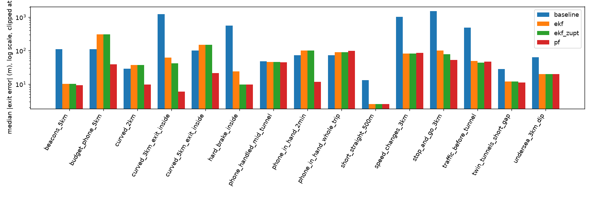
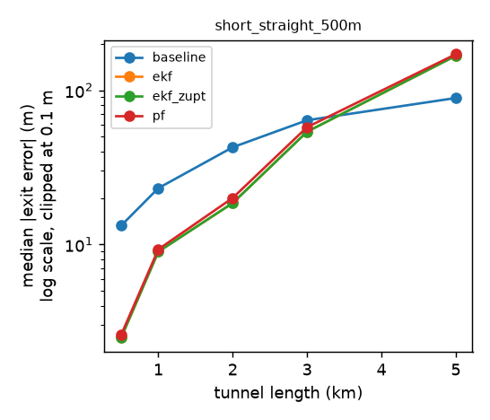
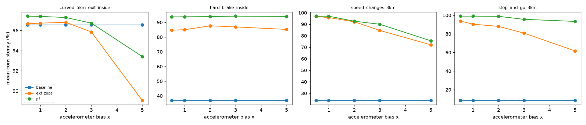
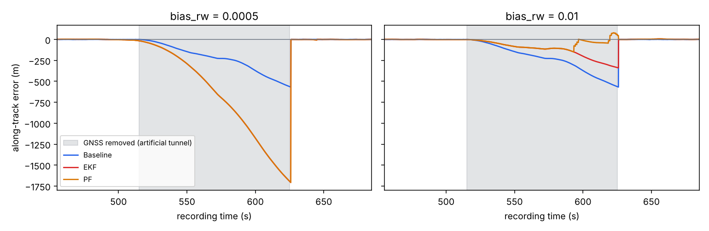

# Through the Tunnel: positioning a car in a GNSS-denied tunnel

*Write-up for the Pointr case study. The code, the scenarios and every number below are in this repository.*

## Summary

This project builds a simulator and four methods that estimate a car's position along the road inside a GNSS-denied
tunnel, and measures how well each method works. In short:

1. **Built a road map first:** the centerline, curvature and grade of the road, the tunnels, the exits and, in some
   scenarios, Bluetooth beacons.
2. **Drove a simulated car along it,** with cruising, speed changes, stops and traffic.
3. **Generated what the phone's sensors would read:** accelerometer and gyroscope, GNSS, barometer, magnetometer and
   beacon signal, each with a noise model from datasheets, an unknown phone orientation and tunnel effects (no GNSS inside).
4. **Gave the estimators only the map and the sensor readings,** never the true position. The truth is used only to score
   them afterwards.
5. **Tried four methods, each adding one source of information:** a constant-speed baseline, an EKF that fuses
   accelerometer, gyroscope, GNSS and beacons, the same EKF with stop detection (EKF + ZUPT), and a particle filter that
   also matches the curves of the road (PF).
6. **Scored them** on 15 scenarios with 300 random seeds each (exit error, error inside the tunnel, honesty of the stated
   uncertainty, exit callouts, recovery after the tunnel), plus two sweeps over the tunnel length and the accelerometer bias.
7. **Checked the approach on real data:** a recorded 14-minute car drive, with GNSS removed in a window to act as a tunnel.
8. **Built a web app** to run, inspect and change all of this live.

Results are in sections 5, 6 and 9; the limits of the work are in section 7.

## 1. Problem and key insight

A driver follows turn-by-turn directions; the road enters a single-lane tunnel 0.5 to 5 km long and GNSS is gone for
minutes. The app still has to show where the car is, call out an exit inside the tunnel at the right moment, and recover
cleanly when the car comes out. Inside the tunnel the phone still has its IMU (accelerometer, gyroscope), a barometer, a
magnetometer and, in some tunnels, Bluetooth beacons.

**Inside a single-lane tunnel on a known route, the problem is one-dimensional.** The car cannot overtake, the route is
known from navigation (A1) and the map gives the centerline, curvature and grade (A2), so the only unknown that matters is
the distance travelled along the road, `s`. Every measurement becomes information about `s` or its derivatives: a GNSS fix
is projected onto the map, a beacon pass is a known `s`, a curve is a place where the gyro must see a known yaw rate. This
keeps the estimators small and every term explainable. A general inertial navigation system in 3D tracks fifteen numbers
(position, velocity, orientation and two sensor offsets, three values each); here the position along the road, the
speed and one accelerometer offset are tracked.

## 2. Approach: layers on top of each other

Four methods, each adding one source of information to the previous one, so the contribution of each layer can be measured.

1. **Baseline.** Use the speed of the last GNSS fix; once GNSS has been missing for 1.5 s (`gap_timeout_s`), use the average
   speed of the last three fixes. Inside a tunnel the position is extrapolated with that average at constant speed, and the
   uncertainty grows linearly. This is what a navigation app does without inertial sensors.
2. **EKF** (extended Kalman filter). It tracks the position `s`, the speed `v` and an accelerometer offset `b` (called bias
   in the code and UI; `bias_rw` is its drift), plus the small remaining error of the forward axis (see alignment below). The
   IMU drives the prediction; GNSS, projected onto the map, corrects it. Every measurement passes a statistical test
   (chi-square gate) and is rejected if it does not fit the filter's belief; five rejections in a row re-initialise the
   filter from the fix. A trust rule decides when the accelerometer may be used: if no GNSS fix has been accepted for 1.5 s
   (`gnss_timeout_s`), the accelerometer is integrated only while the filter's own uncertainty of the offset `b` (its
   standard deviation, taken from the filter's covariance) is below 0.05 m/s² (`accel_trust_sigma_b`). Otherwise the speed
   is held constant. The uncertainty of `b` grows at the rate set by `bias_rw` while the accelerometer is in use, and jumps when the
   phone's mount changes. Measurements reduce it: GNSS fixes and detected stops most, and beacon passes and the weak
   speed-limit prior through the filter's correlations. So an accelerometer that is badly calibrated or drifts fast is switched off by the
   filter itself, and the estimate then behaves like the baseline. Where a scenario has beacons, a beacon
   pass (the peak of the smoothed signal strength) becomes a position measurement.
3. **EKF + ZUPT** (zero-velocity update). When the vibration of the accelerometer and gyro drops below a threshold, the car
   is standing: `v = 0` is applied as a measurement, and the mean acceleration measures the offset `b` directly.
4. **Particle filter (PF).** In a curve the gyro must see `v · curvature(s)`. Two similar curves can both match, so the
   belief about `s` can have several peaks, which a Gaussian filter cannot represent. A particle filter therefore runs on top
   of the EKF + ZUPT and weights particles by how well their expected yaw rate matches the gyro. On a straight road it does
   nothing.

**Alignment is not a method of its own: it is a preparation step inside the EKF** and therefore also inside EKF + ZUPT and
the PF (the baseline does not use it). The phone lies in an unknown orientation, so the filter first has to know which way
the car's forward direction is in the phone's axes. On the open road, with GNSS, the aligner finds "up" from the mean
accelerometer, the gyro bias from straight driving, and the forward axis from a fit between the measured acceleration and
the GNSS speed change. It also detects from the gyro that the phone was picked up and re-aligns after it is put back.

**What the driver sees.**

- **The position on the map.** The estimate can jump when GNSS returns after the tunnel. The arrow on the map therefore
  shows a smoothed position: each second it closes half of the gap to the estimate, it never moves more than 10 m/s faster
  than the car's speed, and it never moves backwards. The arrow does not jump on the screen.
- **The exit callouts.** The app announces the exit 500 m, 200 m and 0 m before it. Call this distance `d`; the estimate is
  `s` with an uncertainty `σ` (one standard deviation), and `k` is a safety factor (1 by default). The announcement fires at
  the first moment when `s + k·σ ≥ exit − d`: as soon as the car might already be `d` metres from the exit, counting the
  uncertainty. The more uncertain the estimate, the earlier the call. A late call is the failure a driver cannot recover
  from; an early call can be ignored.
- **After the exit.** The first GNSS fixes after the portal are poor (A19), but they report a large uncertainty and are
  accepted with little weight. A filter that is confident but wrong is reset by the five-rejection rule above.

## 3. Assumptions that matter most

All assumptions are numbered in [`docs/ASSUMPTIONS.md`](ASSUMPTIONS.md), each with its effect on the results. The ones that
shape the results:

- **A1 single lane, known route** makes the problem one-dimensional; lane changes or an unknown route would need a lateral
  state and map matching over several roads.
- **A2 accurate map (< 2 m)**: the particle filter trusts the curvature, and the road's grade (slope) is used to
  remove the part of gravity that the accelerometer feels on a slope.
- **A3, A4 phone in a mount, at least 60 s of GNSS before the tunnel**: the mount is calibrated in this window; with less,
  the EKF falls back to constant speed. Handling is modelled as separate scenarios.
- **A6 no positioning inside the tunnel** (no repeaters, cellular or Wi-Fi); beacons only where a scenario enables them.
- **A14, A16 sensor quality** from datasheets; the budget phone is the flagship scaled by 2–4×. The bias sweep (5.2) tests
  how much the conclusions depend on this.
- **A17 vibration**, chosen so that standing and moving are separable; stop detection depends on it. A real drive measured
  about twice the simulated level (section 6).
- **A5 no vehicle speed** (OBD, CarPlay, Android Auto); it is the obvious upgrade (section 8).

## 4. What is simulated and how

The estimators never see the truth: the runner gives them only the map and time-ordered measurements, and metrics are
computed on the truth side.

- **World.** A road map at 1 m resolution (curvature, grade, tunnels, exits, beacons) and a vehicle that follows a driving
  plan with cruising, speed changes, stops and traffic, with comfortable, jerk-limited accelerations (A11) and a cruising
  speed that wanders by a few km/h (A27).
- **Sensors.** A 100 Hz IMU with datasheet bias and temperature drift (A14), vibration that grows with speed (A17), a mount
  orientation unknown to the estimator, and handling events. GNSS at 1 Hz with time-correlated errors (A15), degraded near
  portals (A19), absent in the tunnel. Barometer, magnetometer and BLE beacons are simulated as well (A20–A26).
- **Scenarios.** Fifteen, each testing one thing (`scenarios/README.md`); eight are discussed here, all are in
  `docs/results/summary.md`.
- **The simulator.** A web app (FastAPI and React) shows the true position next to each method's estimate, its uncertainty
  band, the sensor streams and the callouts.
  - Every scenario value and estimator parameter can be changed live.
  - A Monte Carlo panel repeats the current scenario with 20 different seeds (about 30 s) and shows the spread of the
    results.
  - A real recording can be replayed with an artificial tunnel (section 6).
  - Several cars can follow each other through one tunnel (A10, A13), but the evaluation uses one car: every phone
    estimates its own position independently, so other cars do not change a phone's result.
- **Determinism.** One seed per run is split into one random stream per sensor, so a run is exactly reproducible.

The barometer is simulated and recorded in the trace, but not used by any method: tunnel ventilation and passing traffic change the pressure by undocumented amounts
that may exceed the altitude signal of a grade (A34). It stays in the simulator, the trace format and the sloped-tunnel scenario `undersea_3km_dip` so that a real recording through a tunnel can test the idea (section 8). The magnetometer is not used either; steel and vehicles disturb it in
tunnels (A23).

## 5. Results

Single runs are misleading: over 300 seeds, EKF + ZUPT leaves `speed_changes_3km` with a median exit error of 88 m, but one
run in ten ends more than 235 m off (Table 1). All numbers therefore come from Monte Carlo runs: **300 seeds** per scenario and method for the main study, 50 for
side studies, 30 per point for sweeps. A seed changes every random draw (noise, driver, traffic, GNSS errors).

Metrics:

- **Exit error (m):** estimated minus true position at the moment the car leaves the tunnel. Negative means the estimate is
  behind the car. The tables show the absolute value.
- **In-tunnel RMSE (m):** root-mean-square position error over all samples inside the tunnel.
- **Consistency (%):** share of tunnel samples where the true error is inside ±2σ of the filter's own uncertainty. About 95%
  means the filter is honest about its uncertainty; lower means over-confident.
- **Callout timing (s):** announcement time minus ideal time (the moment the car really is `d` metres before the exit).
  Negative means early.
- **Recovery time (s):** from the first GNSS fix after the exit until the error stays within 10 m.
- **Largest display jump (m):** the largest sudden step of the position shown on the map, beyond what the car really
  moved. It measures how much the arrow jumps.
- **p90:** the value that 9 out of 10 runs stay below. It shows how bad the unlucky tenth of the runs are.

### 5.1 Main study (300 seeds)

**Table 1. Main study, 300 seeds per scenario and method.** Absolute exit error in metres, as **median / p90** over 300 seeds: the median is the middle run (half of the runs are
better), p90 is the value 9 out of 10 runs stay below. Lower is better; the best method of a row is in bold.

| Scenario | What it tests | Baseline | EKF | EKF + ZUPT | PF |
|---|---|---|---|---|---|
| `speed_changes_3km` | speed changes without stops | 1046 / 1353 | 88 / 235 | 88 / 235 | 89 / 238 |
| `stop_and_go_3km` | traffic with stops | 1500* / 1500* | 86 / 835 | **18 / 38** | 19 / 43 |
| `curved_5km_exit_inside` | longest outage, two curves | 109 / 243 | 142 / 354 | 142 / 354 | **21 / 53** |
| `beacons_5km` | beacons every 400 m | 102 / 250 | **3.3 / 8.1** | 3.3 / 8.1 | 3.5 / 7.9 |
| `budget_phone_5km` | 2–4× worse sensors | 112 / 250 | 259 / 630 | 259 / 630 | **43 / 106** |
| `phone_in_hand_2min` | phone handled for 2 min | 100 / 220 | 105 / 258 | 105 / 258 | **13 / 31** |
| `phone_in_hand_whole_trip` | no alignment possible | 96 / 229 | 109 / 242 | 109 / 242 | 104 / 241 |
| `twin_tunnels_short_gap` | short GNSS window | 32 / 75 | 15 / 35 | 15 / 35 | 15 / 35 |

\* Saturated: the estimate reached the end of the simulated road, so the true error is larger.

*Figure 1. Median absolute exit error per scenario and method (the median values of Table 1 and of the remaining scenarios, see `docs/results/summary.md`).*

**No method wins everywhere; the physics of the scenario decides which one does.**

- **Speed changes: the accelerometer pays off.** The baseline keeps the last speed; the EKF follows the changes
  (1046 m → 88 m, Table 1).
- **Stops: ZUPT pays off.** Without it the EKF has a heavy tail (p90 835 m in `stop_and_go_3km`); with it, 18 m (p90 38 m; Table 1).
- **Map features: the particle filter pays off.** Curves anchor the position: 142 m → 21 m in `curved_5km_exit_inside`,
  259 m → 43 m with the budget phone, 105 m → 13 m when the phone is handled mid-tunnel. Beacons do the same for the EKF on
  a straight tunnel (3.3 m). All values of this list are from Table 1.
- **Long, straight, constant speed: the baseline is hard to beat.** If the car really keeps its speed, constant speed is the
  right model and the accelerometer adds only its drift (5.2). With the phone in the hand for the whole trip, no method
  beats it: the filter cannot relate the accelerometer to the car and falls back to constant speed, as designed.

**Callouts** (source: `docs/results/summary.md`, section "Callout timing")

- None was missed in 18,000 runs (a callout is missed if it never fires before the exit).
- Timing: with the method that suits each scenario the median error is within about 2 s, mostly early, as the `s + k·σ`
  rule intends. Examples: `stop_and_go_3km` with EKF + ZUPT, at 500 m: median −1.2 s, and 9 out of 10 runs within 4.7 s;
  `curved_5km_exit_inside` with the PF, at 500 m: median −0.4 s.

**Recovery** (source: `docs/results/summary.md`, section "Accuracy")

- Median recovery time is 0–2 s for the filters and 3 s for the baseline, so the times alone hardly separate them.
- The difference is what the driver sees: the baseline's map arrow jumps by almost its whole exit error at the first fix
  (median largest jump 100–1400 m), while the filters' largest jump is 1–3 m.
- In `twin_tunnels_short_gap` the 200 m gap is sometimes too short to recover before the second tunnel (16 of 300 runs for
  the filters, 79 for the baseline).

**Consistency** (same source)

- 90–99% for the filters in most scenarios, so their stated uncertainty is about right.
- In a 0.5 km tunnel the EKF is at 79%: somewhat over-confident.

**Cost** (same source)

- The PF costs about 1.4× the EKF per measurement. The absolute time (about 50 µs per measurement for the EKF) was measured
  with several processes running in parallel, so only the ratio is reliable; both are far below the 10 ms between IMU
  samples.

### 5.2 Sweeps: where the approach breaks

*Figure 2. Median absolute exit error against tunnel length, baseline and EKF (30 seeds per point; data: `docs/results/sweeps/tunnel_length_summary.md`).*

**Tunnel length** (straight, constant speed, 0.5–5 km; Figure 2). The EKF beats the baseline up to 2 km (2.5 m vs 13 m at 0.5 km,
19 m vs 43 m at 2 km), they are about equal at 3 km, and at 5 km the baseline wins (89 m vs 167 m). An accelerometer offset
becomes a position error that grows with t²; in a long tunnel without speed changes it outgrows what the accelerometer
gains. The PF cannot help: a straight road has no features.

*Figure 3. Consistency against the accelerometer bias factor (30 seeds per point; data: `docs/results/sweeps/accel_bias_summary.md`).*

**Accelerometer bias** (0.5–5× the simulated phone's bias while the filter keeps assuming the original phone; Figure 3 and the exit-error values in `docs/results/sweeps/accel_bias_summary.md`; 30 seeds per point, so `speed_changes_3km` differs slightly from Table 1). Errors grow
but the ranking holds: at 5× EKF + ZUPT is still 4× better than the baseline in `speed_changes_3km` (228 m vs 1012 m), and
stops limit the damage (`hard_brake_inside`: 6 m → 13 m). The real cost is honesty: a filter that assumes a better phone
than it has becomes over-confident (consistency 90% → 62% in `stop_and_go_3km`). Measuring the real phone's bias is
therefore the first step on real hardware.

### 5.3 What the Monte Carlo study found and fixed

*Before-fix numbers: the 50-seed results at `59d919a` (commit `296dd5d`); after-fix numbers: Table 1.*

The first 50-seed run showed errors that all seeds had on the same side, i.e. biases rather than bad luck:

- **EKF + ZUPT always behind after stops.** The offset update at a stop was weighted with the driving-vibration noise, so
  stops taught the filter almost nothing, and the detector fired while the car still crept at 0.4–0.8 m/s. Fix: measure the
  noise from the stop itself and let `v = 0` correct only the speed. `stop_and_go_3km`: mean −81 m → −16 m, consistency
  20% → 96%, 500 m callout 6.5 s late → 1.2 s early.
- **Beacon fixes 10 m behind.** The 1 s moving average delays the RSSI peak by 0.5 s; the delay is now subtracted
  (consistency 64% → 97%). Raising the beacon noise parameter would also have reached 95% consistency, but it would only
  have hidden the bias.

## 6. A first check with real data

Two recordings made with the Sensor Logger app (iOS) test the most important assumptions on real sensors.

### 6.1 Recordings

**Bus, phone held in the hand** (iPhone 15, 71 s, one stop; `docs/results/bus_in_hand.png`). The phone's own sensor fusion
could not separate tilt from acceleration in the hand: it showed −0.15 m/s² at constant speed and +0.7 to +1.1 m/s² for 6 s
while the bus stood still, which integrated is about 270 m of position error after 70 s. Vibration in the hand stayed high
even at the stop, so the stop detector never fired. Both support the design choice to stop trusting the accelerometer while
the phone is handled.

**Car, phone lying in the charging tray** (iPhone 13, 14 min urban drive with four stops, 85 m height difference;
`data/real/car_mounted/`, published with the driver's permission). The phone was not in a holder: it lay flat and unfixed
in the car's charging tray and could shift during the drive.

- **Vibration is about twice the simulated level.** Standing 0.05 m/s² (simulated 0.03), 0.44 m/s² above 15 m/s
  (simulated 0.23).
- **Stop detection works only partly with the simulated thresholds** (`tools/diagnose_real.py`). It caught 20–68% of the
  stopped time in three of the four stops and nothing in the fourth, where the idle vibration was 0.09 m/s² against a
  0.05 m/s² threshold. The threshold should follow the vehicle's measured vibration rather than be a fixed number.
- **On hills, the "offset" seen at a stop is mostly road grade**: the reading changed by up to 0.3 m/s² from stop to stop,
  in line with the grade at each stop. Without the grade from the map (A2), the offset learned at a stop would be wrong by
  g × grade.

### 6.2 Replay with an artificial tunnel

The recording is converted to the simulator's format (`sim/realdata/`), the map is
built from the drive's own GNSS track, and GNSS is removed for a chosen window, which becomes the tunnel; the "truth" there
is the removed GNSS projected onto the map (about 5 m accurate). The simulator offers this as a "Real recording" mode with
an adjustable window. The default window is 110 s (2.2 km, recording time 515–625 s) in which the car sped up from 52 to
90 km/h without stopping.

*Figure 4. Along-track error of the baseline, EKF and PF in the default window; left: default offset drift, right: 20 times larger. Calibration relaxed in both; the EKF and PF curves of the left panel lie on top of each other. Made by `tools/plot_real_replay.py`.*

**Table 2. Real drive, default window (recording time 515–625 s).** Exit error in metres:

| Setting | Baseline | EKF | PF |
|---|---|---|---|
| Simulator calibration conditions | −563 | −578 | −579 |
| Calibration relaxed for real roads | −563 | −1693 (consistency 0%) | −1692 |
| Relaxed, and offset drift 20× larger | −563 | −335 | +61 |

EKF + ZUPT equals the EKF in every row, because there is no stop in the window. Recovery time is not reported for
the replay: GNSS returns clean after an artificial outage, so it is always about 0 s and does not separate the methods.

### 6.3 Why the default window fails

- **With the simulator's calibration conditions the phone was never calibrated.** The aligner needs flat (< 0.5% grade)
  and straight road; this hilly city route had 4% flat road and no straight road. The EKF held constant speed and ended
  where the baseline did: safe, but no gain.
- **With conditions real roads can meet** (3% grade, 500 m radius) the phone was calibrated after about 5 min, and with
  GNSS the forward acceleration followed the GNSS speed change closely (correlation 0.90). In the outage, however, the EKF's
  speed fell from 12 m/s to almost zero within 60 s while the car accelerated, and it ended 1.7 km behind with 0%
  consistency. A diagnosis against the removed GNSS (`tools/diagnose_real.py`) shows three causes:
  - **An offset that appeared at highway speed.** Before the outage, at city speed, the forward acceleration matched the
    GNSS-derived acceleration within 0.03 m/s²; at 70–90 km/h it read on average 0.14 m/s² lower (0.19 in the first
    40 s), and back at city speed after the outage the difference was 0.06. The filter believed its offset to within
    0.005 m/s² and integrated the difference. This recording cannot tell the cause. Candidates: a vibration-dependent
    offset of the accelerometer (vibration at highway speed was more than twice the city level, and the difference shrank
    again at city speed), a change of the sensor's own offset (for example with temperature; the phone lay in the
    charging tray), a change of the phone's or the car's pitch (0.14 m/s² is the gravity component of a 0.8° tilt), or a
    grade error in the map built from GNSS altitude. A drive with the phone in a fixed holder and the temperature logged
    would separate them.
  - **A feedback loop through the grade.** Gravity is removed with the map's grade at the filter's own position. Once the
    estimate falls behind, it uses the grade of the wrong place, which adds error. Looking the grade up at the true
    position (a diagnostic run only, since it uses the truth) reduces the exit error from −1693 m to −1301 m.
  - **The PF goes blind.** It uses the EKF's speed, and a curve is expected to produce a yaw rate of `v · curvature`; with a
    speed near zero every particle expects no turning, so the curves carry no information.
- **With a 20× larger offset drift** (Table 2; `bias_rw` 0.01 instead of 5·10⁻⁴), the offset uncertainty crosses the trust limit
  after about 14 s and the EKF holds constant speed from there: −335 m, better than the baseline. The PF, anchored by the
  curves in the window, ends at +61 m.

**Table 3. Other windows of the same drive** (calibration relaxed; exit error in metres; `bias_rw` is the offset drift setting, 5·10⁻⁴
is the default):

| Window (s) | Baseline | EKF 5·10⁻⁴ | EKF 0.01 | PF 5·10⁻⁴ | PF 0.01 |
|---|---|---|---|---|---|
| 430–515 | −57 | −77 | −408 | −382 | −485 |
| 515–625 (default) | −563 | −1693 | −335 | −1692 | +61 |
| 640–740 | +477 | +261 | −373 | +94 | −77 |
| 720–820 | −357 | −362 | +76 | −198 | +76 |

The larger drift is not better in general; it fits the default window. In the first window the PF is worse than the
EKF (−382 m against −77 m): map matching does not always help on real data. Windows that start before about 400 s (not
shown) give the same result for both settings, because the phone is not calibrated yet and the EKF holds constant speed.

### 6.4 What this means

Without GNSS, the phone's accelerometer is only as good as the offset it was calibrated with.
Vibration averages out; a permanent change does not, and its position error grows with the square of time: an offset
error of 0.05 m/s² (the gravity component of a 0.3° tilt) costs about 90 m after 60 s and 1.6 km at the end of a 5 km
tunnel driven at 72 km/h. A change of this size can happen even in a fixed holder: a bump, the car's pitch, a grade the
map does not know. The simulator assumed the offset changes as slowly as sensor datasheets say; this drive shows it can
change much faster in a real car, and other windows of the same drive disagree on the best drift setting (Table 3), so the default was not retuned. The accelerometer is
therefore useful for short outages and speed changes, but it cannot carry a long tunnel alone. The design's safety nets
are falling back to constant speed when the offset is uncertain and resetting the position from absolute references:
stops, curves, beacons, or vehicle speed where available. The real drive is the strongest argument for those references,
and for installing beacons in long tunnels.

## 7. Limitations

- **The phone's accelerometer cannot be trusted alone over long outages.** A permanent offset change of a fraction of a
  degree, which one real drive produced and the simulator does not, grows into hundreds of metres within two minutes.
  The simulated offset is too stable, so the simulated EKF results are optimistic; the ranking of what helps (stops,
  curves, beacons) is more trustworthy than the metres.
- **Simulation only, and probably optimistic.** The estimators and the simulator share the same models, so the filter
  knows its noise better than it would in reality. Rankings and mechanisms are more trustworthy than absolute metres.
- **The map is assumed perfect** (A2) and the route known (A1). Curvature errors would directly hurt the PF; repeated,
  identical curves could confuse it.
- **Map matching can hurt on real data:** in one of four replay windows the PF ended farther off than the EKF (section 6.3);
  one drive is too little to say how often.
- **Fixed stop-detection thresholds** miss stops when the idle is loud (section 6).
- **The grade is looked up at the estimated position,** so a position error feeds back into the acceleration (section 6).
  The accelerometer's noise should grow with the grade change over the position uncertainty.
- **Short tunnels:** the EKF is over-confident (79% consistency at 0.5 km; `docs/results/summary.md`, `short_straight_500m`); EKF + ZUPT is still about 16 m behind on
  average in `stop_and_go_3km`.
- **Phone in hand:** the simulated hand motion is probably gentler than a real one, so the PF result in
  `phone_in_hand_2min` is probably optimistic.
- **A false beacon peak is not recovered from** (1 of 300 seeds of `beacons_5km`, exit error 102 m; the maximum in `docs/results/summary.md`): the five-rejection
  reset covers GNSS only.
- **Reflected GNSS fixes that report a small accuracy** at the exit are not modelled.
- **Sensors are delay-free and synchronised** (A8); BLE scanning on real phones adds latency.

## 8. Next steps with real devices

1. **Retune on recordings, then validate.** Set the offset drift, calibration conditions and stop threshold from several
   real drives with the phone in a fixed holder; repeat the artificial-tunnel replay over many windows to get statistics;
   then record a drive through a real tunnel, with the barometer on, to test map matching on slopes.
2. **Port to a phone.** Android `SensorManager` and iOS Core Motion deliver the IMU at 100–200 Hz; the EKF's cost is
   negligible next to the sensors' own power use.
3. **Use vehicle speed when available.** CarPlay, Android Auto or OBD wheel speed removes the tilt problem and most of the
   drift.
4. **Blend motion models.** An interacting multiple model (IMM) filter could switch between constant speed and
   accelerometer-driven motion, removing the long-straight-tunnel weakness (5.2).
5. **Maps.** Tunnel geometry and beacon positions from the operator; a smoother can refine past positions after the exit.

## 9. Conclusions

Values are median absolute exit errors from Table 1 unless another source is named.

- **Accelerometer:** pays off when the speed changes (`speed_changes_3km`: 1046 m for the baseline, 88 m for the EKF).
- **Stop detection:** pays off when the car stops (`stop_and_go_3km`: 86 m for the EKF, 18 m for EKF + ZUPT).
- **Map matching in curves:** pays off with the particle filter (`curved_5km_exit_inside`: 142 m for the EKF, 21 m for the PF;
  `budget_phone_5km`: 259 m, 43 m; `phone_in_hand_2min`: 105 m, 13 m).
- **Beacons:** a median of 3.3 m on a straight 5 km tunnel with beacons every 400 m (`beacons_5km`).
- **Long, straight, constant-speed tunnels:** the constant-speed baseline is hard to beat (5 km tunnel: 89 m for the baseline,
  167 m for the EKF; Figure 2).
- **Callouts:** none missed in 18,000 runs; typically within about 2 s of the ideal time and early rather than late
  (`docs/results/summary.md`).
- **Real data** (one drive, one phone lying in a tray, not fixed; Tables 2 and 3): the simulation is optimistic. A small
  permanent change of the accelerometer offset cost more than a kilometre in a 110 s outage, and the best offset-drift setting
  differs from window to window. The accelerometer cannot carry a long tunnel alone; absolute references (stops, curves,
  beacons, vehicle speed) are essential.

## 10. Method of work

The project was built in small tasks, each with a written goal and acceptance criteria. For every task the agent first
proposed a plan, the plan was approved, the code and a few light tests were written, a short report was reviewed, and the
change was committed on its own. The simulator was developed first, the estimators second, and real data last, so every
layer could be measured against the one below. The full AI log is delivered as a separate report.
